# Unifi-Sun-shades

3D-printed (MSLA resin) sunshades for UniFi Protect devices. Design rules are in [CLAUDE.md](CLAUDE.md).

## v1: Doorbell Lite static sunshade

**Device:** Ubiquiti UniFi Protect Doorbell Lite (UVC-Doorbell-Lite), 137 × 40 × 26.4 mm, rated to 50 °C, with a 5MP fisheye (H 95.8°, V 131.2°, D 175.9°).

**What it is:** one Phrozen TR300 part (41.3 g). A 2.2 mm back flange sits between the wall (or the 20° wedge) and the doorbell's metal plate, held by the doorbell's own screws. Two side walls and a roof stand 2 mm and 14 mm off the body, so air moves through, and a 10 mm brim reaches past the front. Flat mount: no extra hardware. Wedge mount: two plate screws about 2.5 mm longer.

**Viewer:** [interactive 3D viewer](https://claude.ai/artifact/18rUTJPsTf94J8mtnJbxM6) (sun position, shadow readout, install tilt, camera view).

**Files**
- `v1/sunshade_hood_v1.step`, `v1/fit_test_coupon_v1.step`, and `v1/doorbell_lite_envelope_ref.step` (the doorbell's envelope, for reference)
- `v1/print_kit/`: oriented STLs, `PRINT_LIST.md`, `manifest.json`, `verify_report.json`
- `cad/sunshade.py` (model), `cad/verify.py` (checks), `cad/export_kit.py` (orient, export, kit)

**Why the brim stops at 10 mm:** the lens sees 65.6° above horizontal. Any shade that blocks the sun from lower angles would show up in the image. The roof edge sits just outside that cone, so the lens is shaded from about 71° elevation upward. The top and sides of the body are shaded at all sun positions.

**Checks (v1/verify_report.json)**

| Check | Result |
|---|---|
| Doorbell and plate vs hood, installed | 0 mm³ overlap; 2.0 mm minimum gap to walls and roof |
| Hook-on sweep: tilt 10°, 15° and 20°, 4 mm lift, approach, drop, swing in | clear at every step (it first touches at 25° tilt with the lift) |
| Wall and plate screw paths at 66, 74, 92 and 100 mm centres; wedge screw heads 2 mm proud | clear |
| Lock screw and Ø6 screwdriver from below | clear |
| PoE cable through the flange | clear |
| Camera image covered by the shade (fisheye model fitted to the H/V/D field of view) | 1.4% of pixels, all in the extreme corners; side edges 0%, top-edge centre 0.09% |
| STLs | watertight, 1 body each, no sealed voids, lowest point z = 0, nothing flatter than 45° facing down |
| Stress: 4 N (a pigeon) × 3 = 12 N on the brim centre; roof strip 15 mm wide spanning 44 mm between the side walls | 4.6 MPa if the walls hold its ends rigidly, 9.2 MPa if they only support them (limit 10 MPa) |

**Assumptions to confirm:** the screw-hole spacing (74 mm flat, about 92 mm wedge) and the lens position (14.6 mm below the top) were measured from Ubiquiti's to-scale drawing, not published dimensions. The 6 mm slots tolerate ±4 mm. Check that the two small holes on the paper template in the box are about 74 mm apart before printing.

**Rebuild:** `/tmp/cadenv/bin/python cad/sunshade.py && /tmp/cadenv/bin/python cad/verify.py && /tmp/cadenv/bin/python cad/export_kit.py`

## v2: tuned for a wall facing 150° in Doha

**Sun study** (`study/`, `cad/sunpath.py`, `cad/sun_eval.py`): NOAA sun positions for Doha (25.29° N, 51.53° E), every 10 minutes on five dates, ray-traced against the shade and the doorbell.

| Date | Sun on the wall | Highest sun | Sun energy on the doorbell, Wh/day (none / v1 / **v2**) |
|---|---|---|---|
| Jun 21 | 04:55–11:45 | 88° | 29.6 / 5.0 / **2.2** |
| May 1 / Aug 12 | 05:05–12:35 | 80° | 32.7 / 8.5 / **5.0** |
| Mar 21 / Sep 23 | 05:45–14:05 | 65° | 36.5 / 15.0 / **11.5** |
| Feb 5 / Nov 6 | 06:25–15:35 | 49° | 37.1 / 20.6 / **16.9** |
| Dec 21 | 06:25–16:05 | 41° | 35.8 / 22.0 / **18.0** |

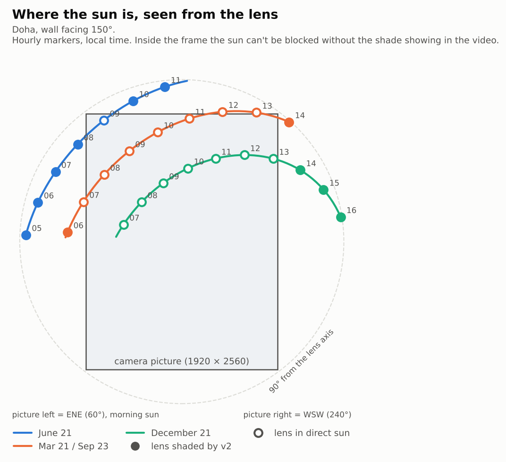
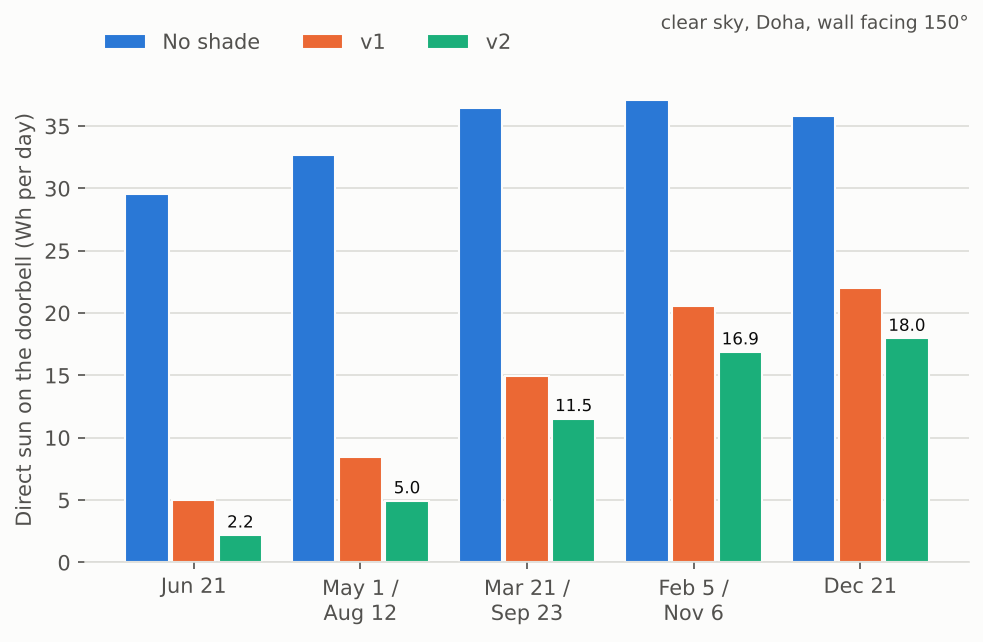

**What the study shows**
- In summer, a 150° wall only gets morning sun: it rises in the ENE, on the camera's left, and passes behind the wall at about 11:45. The hot afternoon sun never reaches the doorbell. The morning sun comes in low from the side, so the side walls do most of the work.
- In winter, the sun is low (41° at noon) and crosses the middle of the camera's picture. No fixed shade can block it there without appearing in the video. Winter heat isn't a risk in Doha, so v2 leaves the picture clear.
- Rule used for v2: shade every sun direction that is outside the picture and nothing inside it. The side walls and roof are built 20 mm deep, then the camera's view volume (fisheye fit, 3° margin for lens-position uncertainty) is cut out. More than 20 mm reach adds nothing.
- Keeping the left wall short (one-sided) saves less than 1 g and loses winter afternoon shade, so v2 is symmetric.
- The result is the same for any wall facing 145–155°, so a compass error or magnetic versus true north doesn't matter.

**v2 checks** (`v2/verify_report.json`): shade in the camera picture 0% (v1: 1.4%). No overlap with the doorbell or plate; 2.0 mm minimum gap. Hook-on sweep at 10°, 15° and 20° clear. Wall and plate screw paths (66–100 mm centres), lock screw and driver, and cable all clear. STL watertight, 1 body, no voids, nothing flatter than 45° facing down. Mass 51.4 g.

**Files:** `v2/sunshade_hood_v2.step`, `v2/print_kit/` (oriented STLs, PRINT_LIST.md, manifest.json, charts), [v2 viewer](https://claude.ai/artifact/JmiTdRrVQLvuYckmAQkXvR) (pick a date and time to see the sun on your wall).

**Rebuild:** `python cad/sunshade_v2.py 20 20 v2 && CAD_VER=v2 python cad/verify.py && CAD_VER=v2 python cad/export_kit.py && python cad/v2_sweep.py <scratch> 150 && python cad/study_charts.py`

## v3: one part that replaces the 20° wedge (doorbell turned toward the entrance)

**Site:** Doha, wall facing 150°. The doorbell sits on the included 20° wedge, turned to the left as you face the wall, so the camera looks at about 170°.

**What changed from v2**
- **One part instead of two:** the printed part *is* the wedge. Its back sits flush on the wall, and the doorbell's metal plate screws to its front with 2 × M3 × 12 countersunk screws into nuts that slide in printed channels (travel −1/+5 mm, for plate holes 90–102 mm apart). The existing wall holes and screws are reused.
- **Looks:** one continuous 2.2 mm shell with R10 top corners, instead of a box. The lip is a single smooth B-spline surface: one reach value per point around the hood's outline, kept under the camera-view limit on both the inner and outer surface, then smoothed. It reaches ~12 mm beside the lens and ~9 mm at the roof, and tucks back only where the fisheye corners look, giving the S-curve.
- **Sun model:** the camera is at 170° and the wall at 150°; the wall's own shade is included.

| Date | Sun energy on the doorbell, Wh/day (no shade → v3) | Cut |
|---|---|---|
| Jun 21 | 15.0 → 0.2 | 99% |
| May 1 / Aug 12 | 19.4 → 3.0 | 85% |
| Mar 21 / Sep 23 | 28.6 → 11.7 | 59% |
| Feb 5 / Nov 6 | 36.4 → 20.8 | 43% |
| Dec 21 | 37.6 → 23.6 | 37% |

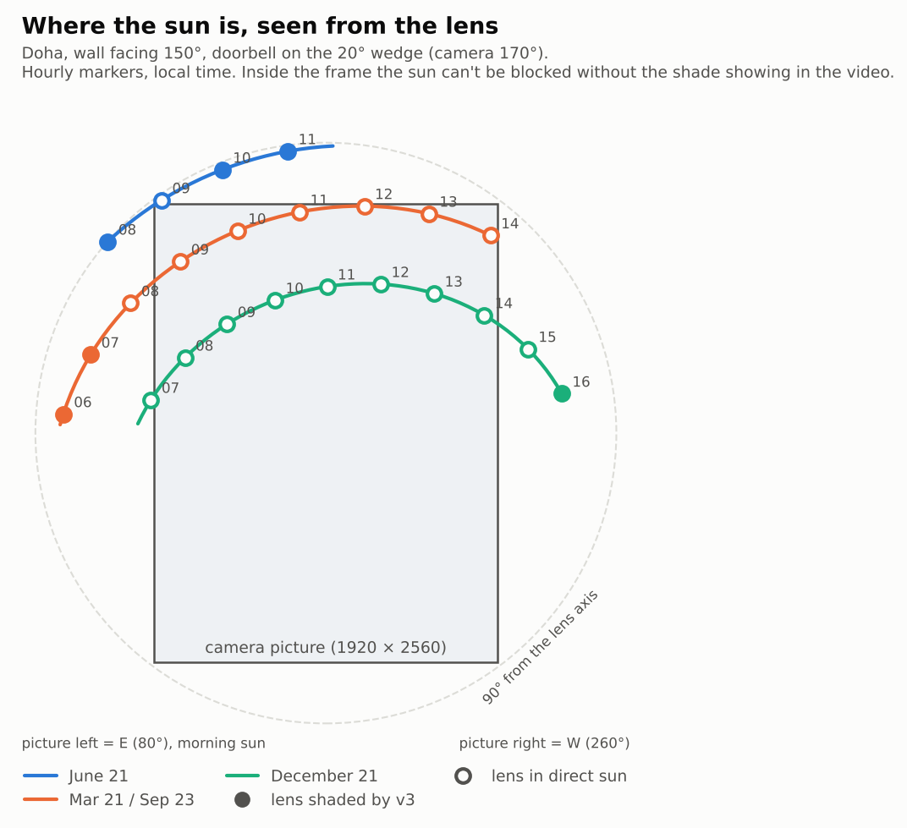
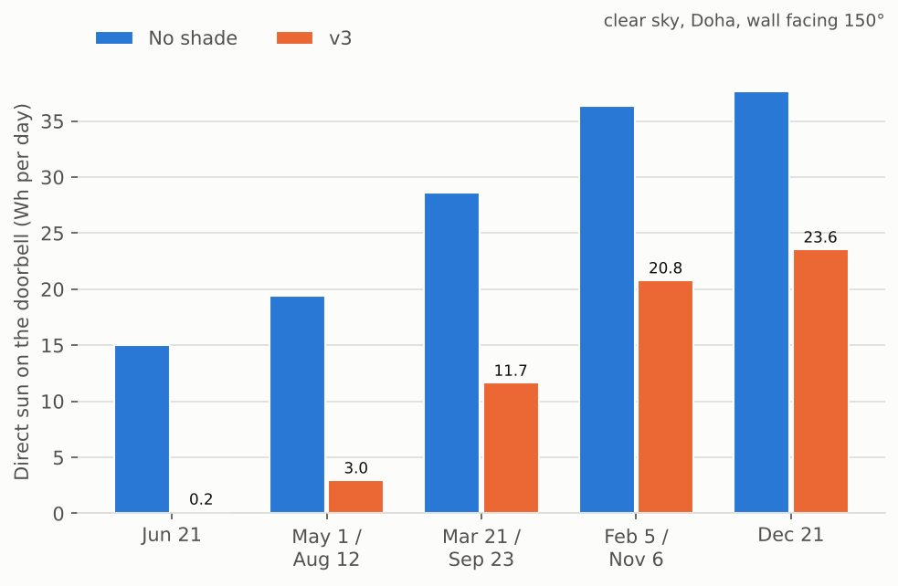

**Checks** (`v3/verify_report.json`):
- Camera picture covered: 0%.
- No overlap with the doorbell or plate; 2.0 mm minimum gap.
- Nothing behind the wall plane.
- Hook-on sweep at 10°, 15° and 20° clear.
- Clear paths: both wall screws (shank, head in its counterbore, Ø6 screwdriver along the axis), both plate screws and nuts across the full travel, the lock screw and driver from below, and the PoE cable.
- Plate-screw tips stay 2.0 mm off the wall.
- STL watertight, 1 body, no voids; 51 mm² flatter than 45°.
- Mass 62.7 g. The mesh figure is used because OpenCascade over-reports the volume of the B-spline lip face by ~2.4 cm³; the mesh and B-rep cross-sections agree.

**Files:** `v3/sunshade_v3.step`, `v3/print_kit/` (oriented STLs, PRINT_LIST.md, manifest.json, charts), [v3 viewer](https://claude.ai/artifact/4nZTFrGL5ToYtyeTtCPmqG).

**Rebuild:** `python cad/sunshade_v3.py && python cad/coupon_v3.py v3 && python cad/verify_v3.py && CAD_VER=v3 python cad/export_kit.py && python cad/sun_eval.py v3/hood.brep study/v3_hood_170.json 170 150 && python cad/study_charts.py v3`

## v4: car-shade style

Same function as v3 (one part that replaces the 20° wedge, back flush to the wall, plate on sliding nuts, lip just outside the camera's picture), an earlier style with a barrel vault, arched ribs and a diamond lattice (replaced by the Islamic geometric designs in v5a).

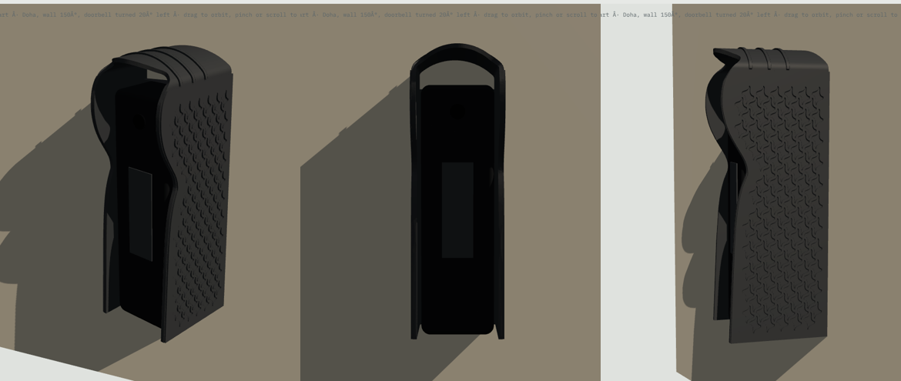

**Styling**
- **Barrel-vault roof:** an R34 arch, crown 18 mm above the doorbell, blended into the sides with R5 fillets.
- **Ribs:** three raised arched ribs across the vault, like the car shade's arch ribs.
- **Lattice:** a framed S-diamond lattice in 0.9 mm relief on both side walls, the car shade's lattice fascia in your window pattern. It's raised rather than cut through, so the morning sun still can't reach the doorbell.
- **Colour:** charcoal to match. Dark runs warmer than light; the air gaps vent it, and light grey or white is the coolest option.

**Results:** sun on the doorbell 15.0 → 0.2 Wh/day on Jun 21 (99%) and 19.4 → 2.9 Wh/day on May 1 / Aug 12 (85%). 0% of the camera picture covered. No overlap with the doorbell or plate (2.0 mm gap). Hook-on clear at 10°, 15° and 20°. All 32 screw, nut, lock-screw and cable paths clear. STL watertight, 1 body, no voids. Mass 70.7 g.

**Files:** `v4/sunshade_hood_v4.step`, `v4/print_kit/`, [v4 viewer](https://claude.ai/artifact/S9xzA8dvoyzbJ85dSpxQDh).

**Rebuild:** `python cad/sunshade_v4.py && CAD_VER=v4 python cad/verify_v3.py && CAD_VER=v4 python cad/export_kit.py && python cad/sun_eval.py v4/hood.brep study/v4_hood_170.json 170 150`

## Wall adapter: mounting over a Qatar switch box

**Problem:** where the doorbell goes, the wall has a Qatar / UK square switch box (BS 4662, 75 mm opening, screw lugs 60.3 mm apart) instead of a flat surface for the wall screws.

**What it is:** one Phrozen TR300 part (63.2 g, 86 × 166 × 10 mm) that covers the box and acts as a new wall.

```
wall + switch box  →  adapter  →  metal plate (flat)  or  20° wedge / v3 / v4 sunshade  →  doorbell
```


- Screws onto the box lugs with the old switch plate's M3.5 screws. The countersinks are flush, so a mount can sit over the heads.
- Two M3 nuts are captured on the centreline 74 mm apart (the Doorbell Lite's wall-screw spacing, which the flat plate, the 20° wedge and v3/v4 all use). They take the place of the wall screws and anchors, and every mount uses M3 × 12 flat-head screws.
- A 24 × 57 mm cable window sits over the box. It contains the flat plate's Ø18 cable hole and lies inside the v3/v4 hollow.
- The 2.4 mm front skin is solid so rain stays out of the box. A rim and ribs on the back carry it, and the back cavities open toward the wall.
- The outline is tall enough for the whole v4 back face (measured from v4's STEP), with 3.5 mm to spare.

**Checks** (`adapter/verify_report.json`): all pass.
- Box opening covered by 5.5 mm at the sides, 35.5 mm below and 55.5 mm above.
- The flat plate sits fully on solid skin, and its cable hole is inside the window and the box.
- The v3 and v4 back edges (both ways round) sit fully on solid skin or the flush box-screw heads, and their plate-nut channels are closed by the adapter face.
- Screw, nut, nut-insertion and box-screw paths have 0 mm³ of plastic in them.
- With M3 × 12, the full nut is engaged and the tip stays 0.9 mm (flat) or 2.3 mm (v3/v4) off the wall.
- STL watertight, 1 body, no sealed voids, nothing flatter than 45° facing down (45° tilt, wall side to the build plate).

**Files:** `adapter/wall_adapter.step`, `adapter/print_kit/` (oriented STLs, PRINT_LIST.md, manifest.json), `adapter/doorbell_lite_wall_adapter_print_kit.zip`, [viewer](https://claude.ai/artifact/23ztJJo4jVdEdtzdfDb4Y9).

**Rebuild:** `python cad/wall_adapter.py && python cad/verify_adapter.py && python cad/adapter_viewer.py && node cad/adapter_shots.js && python cad/export_adapter.py`

## v5a: integrated wedge (superseded by v6)

One printed part with an integrated 20° wedge, centred on the switch box, with Islamic geometric patterns and a nut-pocket plate mount. It was fixed to the wall with new holes above and below the box, which turned out to be the wrong fixing. Its files are kept in `v5a/`. v6 replaces it.

## v6: straight shade, your own angled bracket

One Phrozen TR300 part: a straight, symmetric shade centred on the Qatar / BS 4662 switch box, with an 86 × 86 mm backplate that hides the box. Seen from afar it is square to the wall. Up close, the doorbell sits inside it, angled, on the user's own angled bracket. There is no wedge in the printed part. The side walls carry Islamic geometric relief in one of five patterns.


**Two bolted joints, independent of each other**
- **Shade to the wall:** the switch box's own 2 screws, left and right of the box (lugs 60.3 mm apart), countersunk flush in the 4.8 mm backplate. No drilling. The side walls stand 76 mm apart, outside both screws, so a screwdriver reaches them along the wall normal.
- **Bracket to the shade:** 2 × M3 bolts through the bracket's two wall-screw holes (74 mm apart) into 2 M3 nut pockets (5.7 AF × 2.8 deep, open to the wall side, 4 mm slide). The pockets are 5.3 mm right of the box centre, which centres the angled doorbell inside the hood.

**Shade:** 76 mm wide, 1.6 mm walls, reach up to 64 mm from the wall. The edge is computed along the wall normal to sit just outside the camera picture (3° margin + 1.6 mm, lens modelled 3 mm further out to allow for a thicker bracket). Backplate 4.8 mm thick, hollow behind, with star openwork where the box opening is not behind it.

**Designs** (`v6/print_kit/designs/`, all watertight, one body, 154 mm tall as printed)

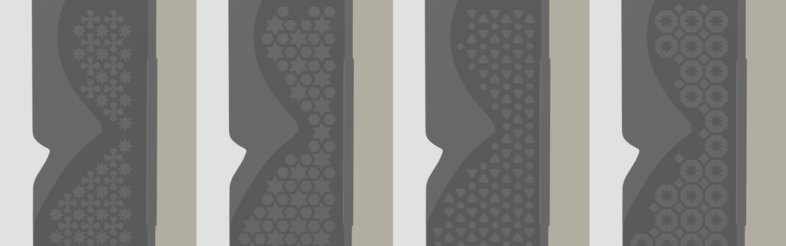

| Pattern | Mass |
|---|---|
| 8-point star (default) | 67.1 g |
| 6-point star | 65.9 g |
| Rosette | 67.2 g |
| Octagon and star | 66.1 g |
| Smooth | 60.5 g |

Patterns are generated in `cad/shade_patterns.py` from tilings (stars with crosses, hexagrams, circle arrangement, octagon-square), each cell shrunk by half the bar width so every bar is 1.4 mm.

**Sun** (Doha, 150° wall, camera at 170°; `study/v6_hood_170.json`), Wh/day on the doorbell:

| Date | No shade | v4 | v6 |
|---|---|---|---|
| Jun 21 | 15.0 | 0.2 | 0.1 |
| May 1 / Aug 12 | 19.4 | 2.9 | 3.5 |
| Mar 21 / Sep 23 | 28.6 | 11.7 | 14.6 |
| Feb 5 / Nov 6 | 36.4 | 20.9 | 24.4 |
| Dec 21 | 37.6 | 23.6 | 26.7 |

The deeper hood matches v4 in midsummer. Otherwise it lets in more low side sun, because the walls must stand 11–13 mm away from the doorbell to clear the box screws. The pattern has no effect.

**Checks** (`v6/verify_report.json`): all pass.
- Doorbell, plate and bracket: 0 mm³ overlap with the part; 3.5 mm minimum gap to the doorbell.
- Hook-on at 10°, 15° and 20° with a 4 mm lift: clear.
- Camera picture covered: 0%.
- 30 screw, nut, driver, lock-screw and cable paths with 0 mm³ of plastic, including a nut dropped into each pocket from the wall side across its whole slide, and a Ø6 driver along each box screw.
- The box is hidden from the front. The doorbell plate's Ø18 cable hole falls inside the cable window.
- STLs watertight, 1 body, no sealed voids; nothing larger than 1.5 mm² flatter than 45° facing down.

**Assumptions to confirm** (they set the nut pockets and the lip): the bracket's two wall-screw holes are 74 mm apart on its centre line; it is the repo's wedge model (3 mm thin edge, 19 mm thick edge, 44 × 137 mm). If the real bracket differs, the pockets move and the lip is recomputed.

**Files:** `v6/sunshade_hood_v6.step`, `v6/print_kit/` (STLs, PRINT_LIST.md, manifest.json), `v6/sunshade_doorbell_lite_v6_print_kit.zip`, [shade designer](https://claude.ai/artifact/EjEeACi4wuyu7NsmFokM8P) (patterns, colours, the angled doorbell, mounting points).

**Rebuild:** `python cad/sunshade_v6.py --pattern khatam && python cad/verify_v6.py && python cad/sun_eval.py v6/hood.brep study/v6_hood_170.json 170 150 && python cad/coupon_v3.py v6 && CAD_VER=v6 python cad/export_kit.py && python cad/export_v6_designs.py`. For the viewer: `python cad/sunshade_v6.py --base`, then `python cad/v6_viewer.py && node cad/v6_shots.js`. `sun_eval.py` reads `v1/device.brep`, which `cad/sunshade.py` writes.

## v7: simple version, small shade, no angle

One Phrozen TR300 part: a small shade that hugs the flat doorbell (48 mm wide, 2.4 mm gap each side), on an 86 × 86 mm backplate that hides the Qatar / BS 4662 switch box. No wedge and no bracket: the doorbell's own metal plate bolts straight onto the part. Everything is centred on the box. 56.7 g with the default pattern (51.5 g smooth).

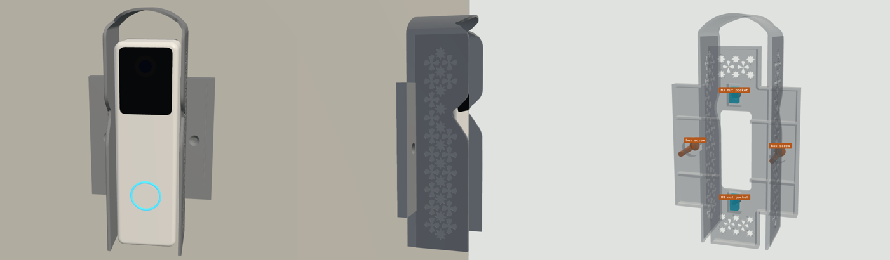

**Two bolted joints, independent of each other**
- **Part to the wall:** the switch box's own 2 screws, left and right of the box, countersunk flush in the backplate's ears. The shade is narrow enough to stand between them, so a screwdriver reaches both along the wall normal. No drilling.
- **Doorbell plate to the part:** 2 × M3 × 8 bolts into 2 M3 nut pockets (5.7 AF × 4.8 deep, open to the wall side, 4 mm slide), 74 mm apart. The 6.8 mm backplate gives the nuts room, so an 8 mm bolt (Voltaat sells that size) reaches the nut and stops above the wall.

**Designs** (`v7/print_kit/designs/`): the same five patterns as v6 (8-point star 56.7 g, 6-point star 56.4 g, rosette 56.6 g, octagon and star 57.0 g, smooth 51.5 g), all watertight, one body, 141 mm tall as printed.

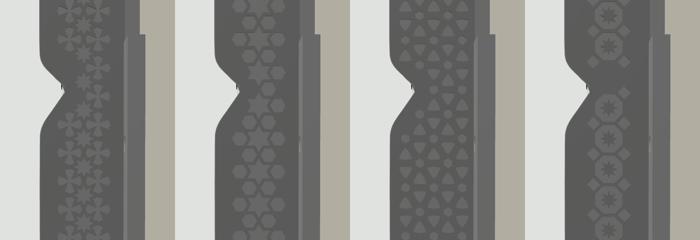

**Sun** (Doha, wall and camera facing 150°; `study/v7_hood_150.json`), Wh/day on the doorbell:

| Date | No shade | v7 | Cut |
|---|---|---|---|
| Jun 21 | 18.7 | 2.4 | 87% |
| May 1 / Aug 12 | 22.4 | 6.7 | 70% |
| Mar 21 / Sep 23 | 29.1 | 13.9 | 52% |
| Feb 5 / Nov 6 | 34.6 | 19.4 | 44% |
| Dec 21 | 35.4 | 20.5 | 42% |

The flat doorbell gets more low morning sun than the angled v4/v6 versions, where turning the doorbell away from the sun does part of the work.

**Checks** (`v7/verify_report.json`): all pass.
- Doorbell and plate: 0 mm³ overlap with the part.
- Hook-on at 10°, 15° and 20° with a 4 mm lift: clear. The first build had a 16 mm roof gap and clashed at 20°; the roof gap is now 19 mm.
- Camera picture covered: 0%.
- 36 screw, nut, driver, lock-screw and cable paths with 0 mm³ of plastic, including a nut dropped into each pocket from the wall side across its whole slide.
- The box is hidden from the front. The plate's Ø18 cable hole falls inside the cable window.
- STLs watertight, 1 body, no sealed voids.

**Assumption to confirm:** the plate's two end holes are 74 mm apart (from Ubiquiti's to-scale drawing).

**Files:** `v7/sunshade_hood_v7.step`, `v7/print_kit/` (STLs, PRINT_LIST.md, manifest.json), `v7/sunshade_doorbell_lite_v7_print_kit.zip`, [viewer](https://claude.ai/artifact/PQCvqXZQqsWxvAeCA9HHaM).

**Rebuild:** `python cad/sunshade_v7.py --pattern khatam && python cad/verify_v7.py && python cad/sun_eval.py v7/hood.brep study/v7_hood_150.json 150 150 && python cad/coupon_v3.py v7 && CAD_VER=v7 python cad/export_kit.py && python cad/export_v7_designs.py`. For the viewer: `python cad/sunshade_v7.py --base`, then `python cad/v7_viewer.py && node cad/v7_shots.js`.

## v8: simple version, thin back flap, nut holders, engraved patterns

The simple version (v7) with three changes:
- **Thin back flap.** 1.6 mm solid, 82 × 82 mm, instead of a 6.8 mm hollow plate with a spine. The shade is unchanged.
- **Nut holders.** Two small raised blocks (12 × 14 mm, 5.2 mm tall) on the front of the flap, 74 mm apart, each with an M3 nut pocket under a 2.0 mm top skin and a window through the flap to drop the nut in from behind. The doorbell plate sits on their tops, 6.8 mm from the wall, as in v7. Two 3.6 mm bosses hold the countersinks for the box screws.
- **Engraved patterns.** The pattern is cut 0.8 mm into the 1.6 mm side walls instead of raised 0.6 mm on them, so a pattern now makes the part lighter than the smooth one. Three new designs: 12-point star, pointed arches, mashrabiya (eight designs in all).

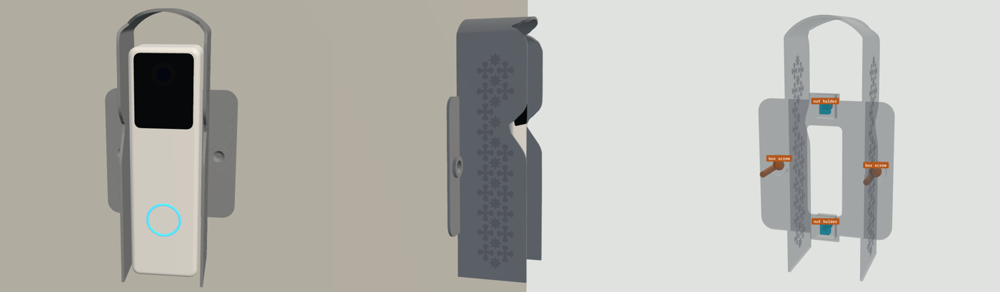

| Design | v7 (raised) | v8 (engraved) |
|---|---|---|
| 8-point star | 56.7 g | 36.0 g |
| 6-point star | 56.4 g | 35.5 g |
| 12-point star | | 35.6 g |
| Rosette | 56.6 g | 35.8 g |
| Octagon and star | 57.0 g | 36.3 g |
| Pointed arches | | 35.5 g |
| Mashrabiya | | 35.4 g |
| Smooth | 51.5 g | 38.2 g |

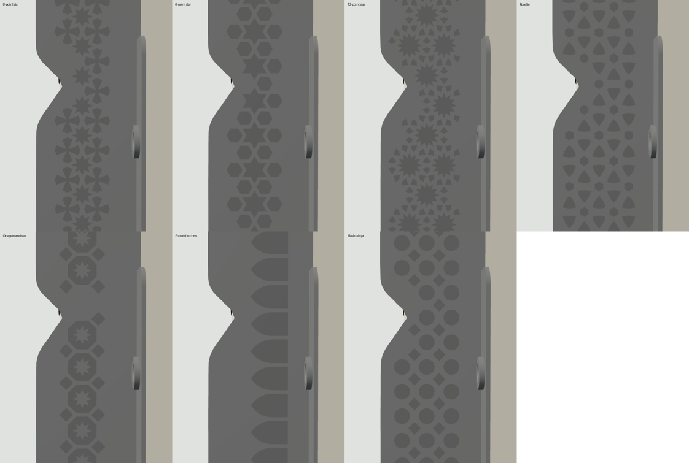

**Mounting** is unchanged: the switch box's own 2 screws left and right (no drilling), and 2 × M3 × 8 into the nut holders.

**Checks** (`v8/verify_report.json`): all pass, as for v7. No overlap with the doorbell or plate, hook-on clear at 10°, 15° and 20°, 0% of the camera picture covered, 36 screw, nut, driver, lock-screw and cable paths clear (including a nut dropped in from the wall side through each flap window), the box hidden from the front, STLs watertight. The sun numbers are the same as v7 (the shade is unchanged).

**Strength:** an estimate, not a finite-element run: about 1 MPa bending stress in the flap at the box screws for the doorbell's weight, and about 7 MPa nut bearing at a hand-tight 100 N.

**Files:** `v8/sunshade_hood_v8.step`, `v8/print_kit/` (STLs for all eight designs, PRINT_LIST.md, manifest.json), `v8/sunshade_doorbell_lite_v8_print_kit.zip`, [viewer](https://claude.ai/artifact/PQCvqXZQqsWxvAeCA9HHaM).

**Rebuild:** `python cad/sunshade_v8.py --pattern khatam && python cad/verify_v8.py && python cad/coupon_v3.py v8 && CAD_VER=v8 python cad/export_kit.py && python cad/export_v8_designs.py`. For the viewer: `python cad/sunshade_v8.py --base`, then `python cad/v8_viewer.py && node cad/v8_shots.js`.

## v9: patterns over the whole face, stepped roof

v8 with two changes:
- **Patterns over the whole face.** The engraved pattern now runs over the whole face of both side walls, edge to edge inside a 2.6 mm frame. Motifs at the edge are cut off by the frame, as in traditional screens, and slivers under about 0.9 mm wide are dropped. The pointed-arch design gets a small round window above each arch.
- **Stepped roof design.** Two rows of stepped pyramids (the crenellation motif; seven in all) are engraved 0.5 mm into the barrel roof, pointing toward the front. It is subtle: it removes 0.15 g and leaves 1.1 mm of roof.

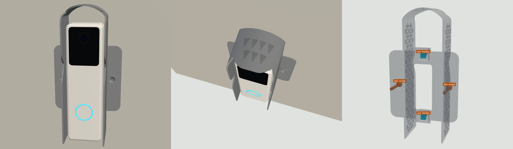


| Design | v8 (band) | v9 (whole face + roof) |
|---|---|---|
| 8-point star | 36.0 g | 34.3 g |
| 6-point star | 35.5 g | 33.3 g |
| 12-point star | 35.6 g | 34.8 g |
| Rosette | 35.8 g | 35.5 g |
| Octagon and star | 36.3 g | 33.6 g |
| Pointed arches | 35.5 g | 34.9 g |
| Mashrabiya | 35.4 g | 34.8 g |
| Smooth | 38.2 g | 38.1 g |

**Checks** (`v9/verify_report.json`): all pass, as for v8: no overlap, hook-on clear at 10°, 15° and 20°, 0% of the camera picture covered, 36 clear screw, nut, driver, lock-screw and cable paths, the box hidden, STLs watertight. The shade shape and lip are unchanged, so the v8/v7 sun numbers apply.

**Files:** `v9/sunshade_hood_v9.step`, `v9/print_kit/` (STLs for all eight designs, PRINT_LIST.md, manifest.json), `v9/sunshade_doorbell_lite_v9_print_kit.zip`, [viewer](https://claude.ai/artifact/PQCvqXZQqsWxvAeCA9HHaM) (with a roof on/off switch and a top view).

**Rebuild:** `python cad/sunshade_v9.py --pattern khatam && python cad/verify_v9.py && python cad/coupon_v3.py v9 && CAD_VER=v9 python cad/export_kit.py && python cad/export_v9_designs.py`. For the viewer: `python cad/sunshade_v9.py --base`, then `python cad/v9_viewer.py && node cad/v9_shots.js`.

