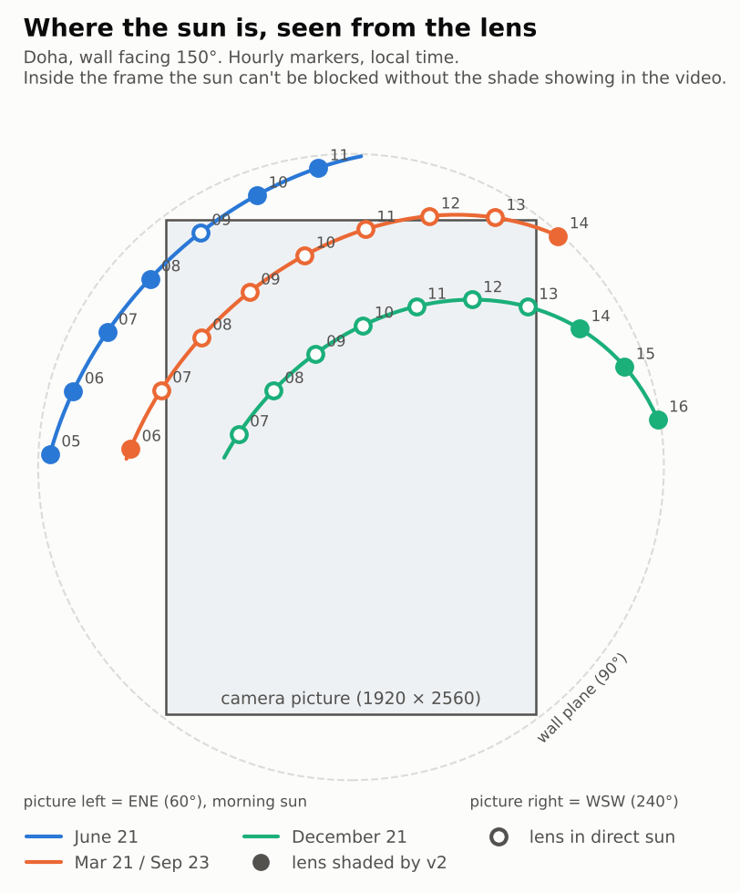

# Unifi-Sun-shades

3D-printed (MSLA resin) sunshades for UniFi Protect devices. Design rules are in [CLAUDE.md](CLAUDE.md).

## v1: Doorbell Lite static sunshade

**Device:** Ubiquiti UniFi Protect Doorbell Lite (UVC-Doorbell-Lite), 137 × 40 × 26.4 mm, rated to 50 °C, with a 5MP fisheye (H 95.8°, V 131.2°, D 175.9°).

**What it is:** one Phrozen TR300 part (41.3 g). A 2.2 mm back flange sits between the wall (or the 20° wedge) and the doorbell's metal plate, held by the doorbell's own screws. Two side walls and a roof stand 2 mm and 14 mm off the body, so air moves through, and a 10 mm brim reaches past the front. Flat mount: no extra hardware. Wedge mount: two plate screws about 2.5 mm longer.

**Viewer:** [interactive 3D viewer](https://claude.ai/artifact/18rUTJPsTf94J8mtnJbxM6) (sun position, shadow readout, install tilt, camera view).

**Files**
- `v1/sunshade_hood_v1.step`, `v1/fit_test_coupon_v1.step`, and `v1/doorbell_lite_envelope_ref.step` (the doorbell's envelope, for reference)
- `v1/print_kit/`: oriented STLs, `PRINT_LIST.md`, `manifest.json`, `verify_report.json`
- `cad/sunshade.py` (model), `cad/verify.py` (checks), `cad/export_kit.py` (orient, export, kit)

**Why the brim stops at 10 mm:** the lens sees 65.6° above horizontal. Any shade that blocks the sun from lower angles would show up in the image. The roof edge sits just outside that cone, so the lens is shaded from about 71° elevation upward. The top and sides of the body are shaded at all sun positions.

**Checks (v1/verify_report.json)**

| Check | Result |
|---|---|
| Doorbell and plate vs hood, installed | 0 mm³ overlap; 2.0 mm minimum gap to walls and roof |
| Hook-on sweep: tilt 10°, 15° and 20°, 4 mm lift, approach, drop, swing in | clear at every step (it first touches at 25° tilt with the lift) |
| Wall and plate screw paths at 66, 74, 92 and 100 mm centres; wedge screw heads 2 mm proud | clear |
| Lock screw and Ø6 screwdriver from below | clear |
| PoE cable through the flange | clear |
| Camera image covered by the shade (fisheye model fitted to the H/V/D field of view) | 1.4% of pixels, all in the extreme corners; side edges 0%, top-edge centre 0.09% |
| STLs | watertight, 1 body each, no sealed voids, lowest point z = 0, nothing flatter than 45° facing down |
| Stress: 4 N (a pigeon) × 3 = 12 N on the brim centre; roof strip 15 mm wide spanning 44 mm between the side walls | 4.6 MPa if the walls hold its ends rigidly, 9.2 MPa if they only support them (limit 10 MPa) |

**Assumptions to confirm:** the screw-hole spacing (74 mm flat, about 92 mm wedge) and the lens position (14.6 mm below the top) were measured from Ubiquiti's to-scale drawing, not published dimensions. The 6 mm slots tolerate ±4 mm. Check that the two small holes on the paper template in the box are about 74 mm apart before printing.

**Rebuild:** `/tmp/cadenv/bin/python cad/sunshade.py && /tmp/cadenv/bin/python cad/verify.py && /tmp/cadenv/bin/python cad/export_kit.py`

## v2: tuned for a wall facing 150° in Doha

**Sun study** (`study/`, `cad/sunpath.py`, `cad/sun_eval.py`): NOAA sun positions for Doha (25.29° N, 51.53° E), every 10 minutes on five dates, ray-traced against the shade and the doorbell.

| Date | Sun on the wall | Highest sun | Sun energy on the doorbell, Wh/day (none / v1 / **v2**) |
|---|---|---|---|
| Jun 21 | 04:55–11:45 | 88° | 29.6 / 5.0 / **2.2** |
| May 1 / Aug 12 | 05:05–12:35 | 80° | 32.7 / 8.5 / **5.0** |
| Mar 21 / Sep 23 | 05:45–14:05 | 65° | 36.5 / 15.0 / **11.5** |
| Feb 5 / Nov 6 | 06:25–15:35 | 49° | 37.1 / 20.6 / **16.9** |
| Dec 21 | 06:25–16:05 | 41° | 35.8 / 22.0 / **18.0** |

**What the study shows**
- In summer, a 150° wall only gets morning sun: it rises in the ENE, on the camera's left, and passes behind the wall at about 11:45. The hot afternoon sun never reaches the doorbell. The morning sun comes in low from the side, so the side walls do most of the work.
- In winter, the sun is low (41° at noon) and crosses the middle of the camera's picture. No fixed shade can block it there without appearing in the video. Winter heat isn't a risk in Doha, so v2 leaves the picture clear.
- Rule used for v2: shade every sun direction that is outside the picture and nothing inside it. The side walls and roof are built 20 mm deep, then the camera's view volume (fisheye fit, 3° margin for lens-position uncertainty) is cut out. More than 20 mm reach adds nothing.
- Keeping the left wall short (one-sided) saves less than 1 g and loses winter afternoon shade, so v2 is symmetric.
- The result is the same for any wall facing 145–155°, so a compass error or magnetic versus true north doesn't matter.

**v2 checks** (`v2/verify_report.json`): shade in the camera picture 0% (v1: 1.4%). No overlap with the doorbell or plate; 2.0 mm minimum gap. Hook-on sweep at 10°, 15° and 20° clear. Wall and plate screw paths (66–100 mm centres), lock screw and driver, and cable all clear. STL watertight, 1 body, no voids, nothing flatter than 45° facing down. Mass 51.4 g.

**Files:** `v2/sunshade_hood_v2.step`, `v2/print_kit/` (oriented STLs, PRINT_LIST.md, manifest.json, charts), [v2 viewer](https://claude.ai/artifact/JmiTdRrVQLvuYckmAQkXvR) (pick a date and time to see the sun on your wall).

**Rebuild:** `python cad/sunshade_v2.py 20 20 v2 && CAD_VER=v2 python cad/verify.py && CAD_VER=v2 python cad/export_kit.py && python cad/v2_sweep.py <scratch> 150 && python cad/study_charts.py`
