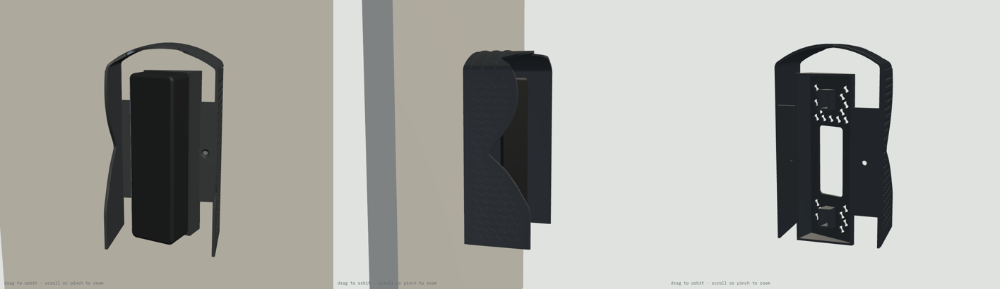

# Unifi-Sun-shades

3D-printed (MSLA resin) sunshades for UniFi Protect devices. Design rules are in [CLAUDE.md](CLAUDE.md).

## v1: Doorbell Lite static sunshade

**Device:** Ubiquiti UniFi Protect Doorbell Lite (UVC-Doorbell-Lite), 137 × 40 × 26.4 mm, rated to 50 °C, with a 5MP fisheye (H 95.8°, V 131.2°, D 175.9°).

**What it is:** one Phrozen TR300 part (41.3 g). A 2.2 mm back flange sits between the wall (or the 20° wedge) and the doorbell's metal plate, held by the doorbell's own screws. Two side walls and a roof stand 2 mm and 14 mm off the body, so air moves through, and a 10 mm brim reaches past the front. Flat mount: no extra hardware. Wedge mount: two plate screws about 2.5 mm longer.

**Viewer:** [interactive 3D viewer](https://claude.ai/artifact/18rUTJPsTf94J8mtnJbxM6) (sun position, shadow readout, install tilt, camera view).

**Files**
- `v1/sunshade_hood_v1.step`, `v1/fit_test_coupon_v1.step`, and `v1/doorbell_lite_envelope_ref.step` (the doorbell's envelope, for reference)
- `v1/print_kit/`: oriented STLs, `PRINT_LIST.md`, `manifest.json`, `verify_report.json`
- `cad/sunshade.py` (model), `cad/verify.py` (checks), `cad/export_kit.py` (orient, export, kit)

**Why the brim stops at 10 mm:** the lens sees 65.6° above horizontal. Any shade that blocks the sun from lower angles would show up in the image. The roof edge sits just outside that cone, so the lens is shaded from about 71° elevation upward. The top and sides of the body are shaded at all sun positions.

**Checks (v1/verify_report.json)**

| Check | Result |
|---|---|
| Doorbell and plate vs hood, installed | 0 mm³ overlap; 2.0 mm minimum gap to walls and roof |
| Hook-on sweep: tilt 10°, 15° and 20°, 4 mm lift, approach, drop, swing in | clear at every step (it first touches at 25° tilt with the lift) |
| Wall and plate screw paths at 66, 74, 92 and 100 mm centres; wedge screw heads 2 mm proud | clear |
| Lock screw and Ø6 screwdriver from below | clear |
| PoE cable through the flange | clear |
| Camera image covered by the shade (fisheye model fitted to the H/V/D field of view) | 1.4% of pixels, all in the extreme corners; side edges 0%, top-edge centre 0.09% |
| STLs | watertight, 1 body each, no sealed voids, lowest point z = 0, nothing flatter than 45° facing down |
| Stress: 4 N (a pigeon) × 3 = 12 N on the brim centre; roof strip 15 mm wide spanning 44 mm between the side walls | 4.6 MPa if the walls hold its ends rigidly, 9.2 MPa if they only support them (limit 10 MPa) |

**Assumptions to confirm:** the screw-hole spacing (74 mm flat, about 92 mm wedge) and the lens position (14.6 mm below the top) were measured from Ubiquiti's to-scale drawing, not published dimensions. The 6 mm slots tolerate ±4 mm. Check that the two small holes on the paper template in the box are about 74 mm apart before printing.

**Rebuild:** `/tmp/cadenv/bin/python cad/sunshade.py && /tmp/cadenv/bin/python cad/verify.py && /tmp/cadenv/bin/python cad/export_kit.py`

## v2: tuned for a wall facing 150° in Doha

**Sun study** (`study/`, `cad/sunpath.py`, `cad/sun_eval.py`): NOAA sun positions for Doha (25.29° N, 51.53° E), every 10 minutes on five dates, ray-traced against the shade and the doorbell.

| Date | Sun on the wall | Highest sun | Sun energy on the doorbell, Wh/day (none / v1 / **v2**) |
|---|---|---|---|
| Jun 21 | 04:55–11:45 | 88° | 29.6 / 5.0 / **2.2** |
| May 1 / Aug 12 | 05:05–12:35 | 80° | 32.7 / 8.5 / **5.0** |
| Mar 21 / Sep 23 | 05:45–14:05 | 65° | 36.5 / 15.0 / **11.5** |
| Feb 5 / Nov 6 | 06:25–15:35 | 49° | 37.1 / 20.6 / **16.9** |
| Dec 21 | 06:25–16:05 | 41° | 35.8 / 22.0 / **18.0** |


**What the study shows**
- In summer, a 150° wall only gets morning sun: it rises in the ENE, on the camera's left, and passes behind the wall at about 11:45. The hot afternoon sun never reaches the doorbell. The morning sun comes in low from the side, so the side walls do most of the work.
- In winter, the sun is low (41° at noon) and crosses the middle of the camera's picture. No fixed shade can block it there without appearing in the video. Winter heat isn't a risk in Doha, so v2 leaves the picture clear.
- Rule used for v2: shade every sun direction that is outside the picture and nothing inside it. The side walls and roof are built 20 mm deep, then the camera's view volume (fisheye fit, 3° margin for lens-position uncertainty) is cut out. More than 20 mm reach adds nothing.
- Keeping the left wall short (one-sided) saves less than 1 g and loses winter afternoon shade, so v2 is symmetric.
- The result is the same for any wall facing 145–155°, so a compass error or magnetic versus true north doesn't matter.

**v2 checks** (`v2/verify_report.json`): shade in the camera picture 0% (v1: 1.4%). No overlap with the doorbell or plate; 2.0 mm minimum gap. Hook-on sweep at 10°, 15° and 20° clear. Wall and plate screw paths (66–100 mm centres), lock screw and driver, and cable all clear. STL watertight, 1 body, no voids, nothing flatter than 45° facing down. Mass 51.4 g.

**Files:** `v2/sunshade_hood_v2.step`, `v2/print_kit/` (oriented STLs, PRINT_LIST.md, manifest.json, charts), [v2 viewer](https://claude.ai/artifact/JmiTdRrVQLvuYckmAQkXvR) (pick a date and time to see the sun on your wall).

**Rebuild:** `python cad/sunshade_v2.py 20 20 v2 && CAD_VER=v2 python cad/verify.py && CAD_VER=v2 python cad/export_kit.py && python cad/v2_sweep.py <scratch> 150 && python cad/study_charts.py`

## v3: one part that replaces the 20° wedge (doorbell turned toward the entrance)

**Site:** Doha, wall facing 150°. The doorbell sits on the included 20° wedge, turned to the left as you face the wall, so the camera looks at about 170°.

**What changed from v2**
- **One part instead of two:** the printed part *is* the wedge. Its back sits flush on the wall, and the doorbell's metal plate screws to its front with 2 × M3 × 12 countersunk screws into nuts that slide in printed channels (travel −1/+5 mm, for plate holes 90–102 mm apart). The existing wall holes and screws are reused.
- **Looks:** one continuous 2.2 mm shell with R10 top corners, instead of a box. The lip is a single smooth B-spline surface: one reach value per point around the hood's outline, kept under the camera-view limit on both the inner and outer surface, then smoothed. It reaches ~12 mm beside the lens and ~9 mm at the roof, and tucks back only where the fisheye corners look, giving the S-curve.
- **Sun model:** the camera is at 170° and the wall at 150°; the wall's own shade is included.

| Date | Sun energy on the doorbell, Wh/day (no shade → v3) | Cut |
|---|---|---|
| Jun 21 | 15.0 → 0.2 | 99% |
| May 1 / Aug 12 | 19.4 → 3.0 | 85% |
| Mar 21 / Sep 23 | 28.6 → 11.7 | 59% |
| Feb 5 / Nov 6 | 36.4 → 20.8 | 43% |
| Dec 21 | 37.6 → 23.6 | 37% |


**Checks** (`v3/verify_report.json`):
- Camera picture covered: 0%.
- No overlap with the doorbell or plate; 2.0 mm minimum gap.
- Nothing behind the wall plane.
- Hook-on sweep at 10°, 15° and 20° clear.
- Clear paths: both wall screws (shank, head in its counterbore, Ø6 screwdriver along the axis), both plate screws and nuts across the full travel, the lock screw and driver from below, and the PoE cable.
- Plate-screw tips stay 2.0 mm off the wall.
- STL watertight, 1 body, no voids; 51 mm² flatter than 45°.
- Mass 62.7 g. The mesh figure is used because OpenCascade over-reports the volume of the B-spline lip face by ~2.4 cm³; the mesh and B-rep cross-sections agree.

**Files:** `v3/sunshade_v3.step`, `v3/print_kit/` (oriented STLs, PRINT_LIST.md, manifest.json, charts), [v3 viewer](https://claude.ai/artifact/4nZTFrGL5ToYtyeTtCPmqG).

**Rebuild:** `python cad/sunshade_v3.py && python cad/coupon_v3.py v3 && python cad/verify_v3.py && CAD_VER=v3 python cad/export_kit.py && python cad/sun_eval.py v3/hood.brep study/v3_hood_170.json 170 150 && python cad/study_charts.py v3`

## v4: car-shade style

Same function as v3 (one part that replaces the 20° wedge, back flush to the wall, plate on sliding nuts, lip just outside the camera's picture), restyled after the arched car shade next to the doorbell ([reference](study/car_shade_reference.jpg)).


**Styling**
- **Barrel-vault roof:** an R34 arch, crown 18 mm above the doorbell, blended into the sides with R5 fillets.
- **Ribs:** three raised arched ribs across the vault, like the car shade's arch ribs.
- **Lattice:** a framed S-diamond lattice in 0.9 mm relief on both side walls, the car shade's lattice fascia in your window pattern. It's raised rather than cut through, so the morning sun still can't reach the doorbell.
- **Colour:** charcoal to match. Dark runs warmer than light; the air gaps vent it, and light grey or white is the coolest option.

**Results:** sun on the doorbell 15.0 → 0.2 Wh/day on Jun 21 (99%) and 19.4 → 2.9 Wh/day on May 1 / Aug 12 (85%). 0% of the camera picture covered. No overlap with the doorbell or plate (2.0 mm gap). Hook-on clear at 10°, 15° and 20°. All 32 screw, nut, lock-screw and cable paths clear. STL watertight, 1 body, no voids. Mass 70.7 g.

**Files:** `v4/sunshade_hood_v4.step`, `v4/print_kit/`, [v4 viewer](https://claude.ai/artifact/S9xzA8dvoyzbJ85dSpxQDh).

**Rebuild:** `python cad/sunshade_v4.py && CAD_VER=v4 python cad/verify_v3.py && CAD_VER=v4 python cad/export_kit.py && python cad/sun_eval.py v4/hood.brep study/v4_hood_170.json 170 150`

## Wall adapter: mounting over a Qatar switch box

**Problem:** where the doorbell goes, the wall has a Qatar / UK square switch box (BS 4662, 75 mm opening, screw lugs 60.3 mm apart) instead of a flat surface for the wall screws.

**What it is:** one Phrozen TR300 part (63.2 g, 86 × 166 × 10 mm) that covers the box and acts as a new wall.

```
wall + switch box  →  adapter  →  metal plate (flat)  or  20° wedge / v3 / v4 sunshade  →  doorbell
```


- Screws onto the box lugs with the old switch plate's M3.5 screws. The countersinks are flush, so a mount can sit over the heads.
- Two M3 nuts are captured on the centreline 74 mm apart (the Doorbell Lite's wall-screw spacing, which the flat plate, the 20° wedge and v3/v4 all use). They take the place of the wall screws and anchors, and every mount uses M3 × 12 flat-head screws.
- A 24 × 57 mm cable window sits over the box. It contains the flat plate's Ø18 cable hole and lies inside the v3/v4 hollow.
- The 2.4 mm front skin is solid so rain stays out of the box. A rim and ribs on the back carry it, and the back cavities open toward the wall.
- The outline is tall enough for the whole v4 back face (measured from v4's STEP), with 3.5 mm to spare.

**Checks** (`adapter/verify_report.json`): all pass.
- Box opening covered by 5.5 mm at the sides, 35.5 mm below and 55.5 mm above.
- The flat plate sits fully on solid skin, and its cable hole is inside the window and the box.
- The v3 and v4 back edges (both ways round) sit fully on solid skin or the flush box-screw heads, and their plate-nut channels are closed by the adapter face.
- Screw, nut, nut-insertion and box-screw paths have 0 mm³ of plastic in them.
- With M3 × 12, the full nut is engaged and the tip stays 0.9 mm (flat) or 2.3 mm (v3/v4) off the wall.
- STL watertight, 1 body, no sealed voids, nothing flatter than 45° facing down (45° tilt, wall side to the build plate).

**Files:** `adapter/wall_adapter.step`, `adapter/print_kit/` (oriented STLs, PRINT_LIST.md, manifest.json), `adapter/doorbell_lite_wall_adapter_print_kit.zip`, [viewer](https://claude.ai/artifact/23ztJJo4jVdEdtzdfDb4Y9).

**Rebuild:** `python cad/wall_adapter.py && python cad/verify_adapter.py && python cad/adapter_viewer.py && node cad/adapter_shots.js && python cad/export_adapter.py`

## v5: one piece, centred on the switch box (two variants)

Both variants are a single Phrozen TR300 part: the sunshade, the 20° wedge, and a 2.0 mm cover that hides the Qatar / BS 4662 switch box. Both are centred on the box. (An earlier v5 that sat 17 mm off-centre was dropped.)

| | **v5a: centred, v4 shape** | **v5b: box-sized** |
|---|---|---|
| Look | v4's shade centred on a symmetric 86 × 86 mm backplate | the hood itself is 86 mm wide (a switch plate's width), side walls square to the wall |
| Mass | **58.0 g** | **70.0 g** |
| Fixing | the doorbell kit's 2 × M3 screws + plugs in 2 new holes, 60 mm above and below the box centre, hidden under the plate (the shade sits over the box lugs) | the box's own 2 screws, inside the hood beside the wedge; no drilling |
| Shade | same as v4 | less: 10–16 mm side gaps let low side sun in |
| Prints (45° tilt) | 81.5 × 144.8 × 152.0 mm | 87.8 × 151.4 × 148.7 mm |




**Weight savings in both** (from v4 + adapter, 134 g):
- 1.8 mm shell;
- 2.0 mm seat with S-diamond windows under the doorbell;
- no centre spine;
- nut blocks trimmed to 9.2 × 16;
- lattice relief 0.6 mm.

In v5a the shell is also the wedge's side wall.

**Sun** (Doha, 150° wall, camera at 170°; `study/v5a_hood_170.json`, `study/v5b_hood_170.json`):

| Date | No shade | v4 | v5a | v5b (Wh/day on the doorbell) |
|---|---|---|---|---|
| Jun 21 | 15.0 | 0.2 | 0.2 | 0.5 |
| May 1 / Aug 12 | 19.4 | 2.9 | 3.0 | 5.8 |
| Mar 21 / Sep 23 | 28.6 | 11.7 | 11.8 | 17.7 |
| Feb 5 / Nov 6 | 36.4 | 20.9 | 21.1 | 26.3 |
| Dec 21 | 37.6 | 23.6 | 23.8 | 27.6 |

v5a keeps v4's shade exactly. v5b looks bigger but shades less. Its lip is cut to the camera picture in the same way, but its side walls stand 10–16 mm off the doorbell. This agrees with the v2 sweep (`study/sweep_150.json`): more reach adds nothing, and moving the walls away from the body costs shade.

**Checks** (`v5a/verify_report.json`, `v5b/verify_report.json`), all pass on both:
- Doorbell and plate: 0 mm³ overlap.
- Hook-on at 10°, 15° and 20° with a 4 mm lift: clear.
- Camera picture covered: 0%.
- Screw, Ø6 driver, plate-nut, lock-screw and cable paths clear (28 on v5a, 30 on v5b).
- The box is hidden from the front.
- STLs watertight, 1 body, no sealed voids. The only faces flatter than 45° facing down are 0.6 mm lattice ledges, as on v4. v5b is oriented in the wall frame because its walls are square to the wall.

**Files:** `v5a/`, `v5b/` (STEP, `print_kit/`, print-kit zip), [viewer with both variants](https://claude.ai/artifact/EjEeACi4wuyu7NsmFokM8P).

**Rebuild:** `python cad/sunshade_v5a.py && python cad/sunshade_v5b.py && python cad/verify_v5.py v5a && python cad/verify_v5.py v5b && python cad/sun_eval.py v5a/hood.brep study/v5a_hood_170.json 170 150` (same for v5b) `&& CAD_VER=v5a python cad/export_kit.py && CAD_VER=v5b python cad/export_kit.py && python cad/v5_viewer.py && node cad/v5_shots.js`. `sun_eval.py` reads `v1/device.brep`, which `cad/sunshade.py` writes.
