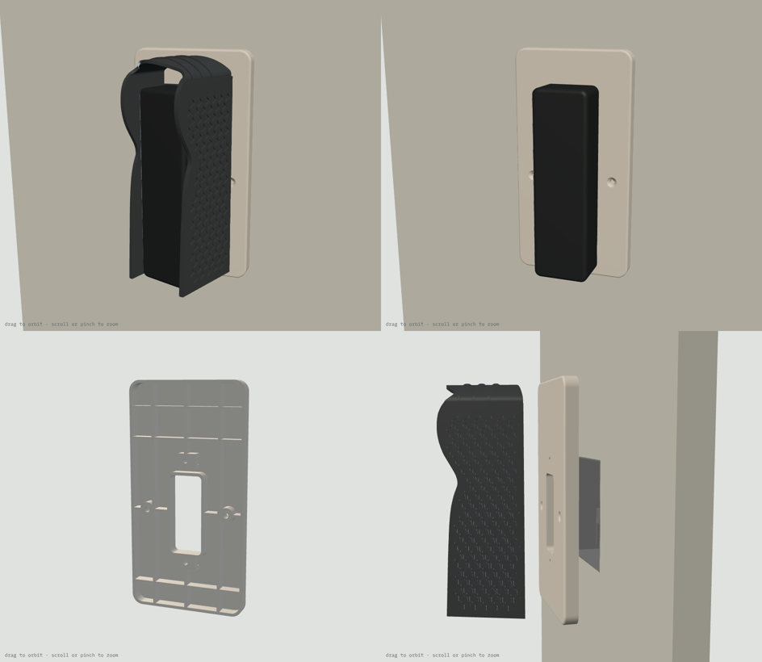

# Doorbell Lite wall adapter: print list

**A plate that goes between the wall and your UniFi Protect Doorbell Lite's mount, where the wall has a Qatar / UK square switch box (BS 4662, 3×3") instead of a flat surface.**

```
wall + switch box  →  THIS ADAPTER  →  doorbell's metal plate (flat)  or  20° wedge / v3 / v4 sunshade  →  doorbell
```

- It covers the box opening and screws onto the box with the box's own two screws (60.3 mm apart, left and right). Their countersinks are flush, so the doorbell's mount can sit over them.
- On its front are two captured M3 nuts on the centreline, 74 mm apart. That is the Doorbell Lite's wall-screw spacing, and the flat metal plate, the 20° wedge and the v3/v4 sunshades all use it. The adapter replaces the wall screws and anchors.
- The cable comes out of the box through a 24 × 57 mm window. The flat plate's Ø18 cable hole sits over it, and the window also lies inside the hollow behind the v3/v4 wedge.
- The front face is solid (2.4 mm) so rain can't get into the box. Ribs and a rim on the back carry it.



## Parts

| File | Qty | Resin | Purpose |
|---|---|---|---|
| `wall_adapter_TR300.stl` | 1 | Phrozen TR300 | The adapter, 86 × 166 × 10 mm, 63.2 g |
| `fit_test_coupon_adapter_TR300.stl` | 1 | Phrozen TR300 | Scale frame (62.00 X / 62.00 Y, 56.60 Z), M3 nut channels 5.6 / 5.7 / 5.8, M3 holes 3.3 / 3.4 / 3.5, and an M3.5 box-screw hole with countersink (3.9 / 7.4). 6.5 g |

STEP files for both are included.

## Orientation and supports

**Adapter:** the STL is pre-oriented, so don't rotate it.
- Long axis 45° from vertical, with the back (wall side) toward the build plate.
- The back cavities and nut channels open toward the build plate, so there are no suction cups. All down-facing surfaces are at 45° or steeper (0 mm² flatter).
- **Supports** go on the back rim and rib edges only. They sit against the wall, so marks there don't show.
- **No supports** on the front face (the doorbell's mount sits on it), in the countersinks or nut channels, or on the cable-window edge.

**Coupon:** print it axis-aligned and flat, as exported.

## Scale and fits (do this first)

1. Print the coupon and post-process it like the real part.
2. Measure the frame (drawn 62.00 X / 62.00 Y) and the tower (drawn 56.60 Z). Set the slicer scale per axis to drawn ÷ measured × 100 %.
3. Slide an M3 nut through the three channels. The part is drawn at **5.7**. Use the narrowest channel the nut slides through without turning, and tell me if that isn't 5.7.
4. Push an M3 screw through the three holes (the part uses 3.4). Try one of your old switch-plate screws in the box-screw hole: its head should sit flush in the countersink.

## Post-processing (TR300)

Wash and remove supports. Clear the nut channels, countersinks and holes with a pick. Cure 15 min dry, no heat.

## Fits

| Feature | Size | Notes |
|---|---|---|
| Box-screw holes | Ø3.9, 90° countersink Ø7.4, 60.3 mm c/c at the box centre | Old M3.5 switch-plate screws; heads end flush |
| Doorbell screw holes | Ø3.4, 74 mm c/c on the centreline | Doorbell Lite template spacing |
| Nut channels | 5.7 AF × 2.6, enter sideways from the back cavity next to each screw hole, nut sits against the 2.4 mm front skin | Nut slides in, can't turn; the screw pulls it against the skin |
| Cable window | 24 × 57 mm, 30.5 below / 26.5 above the screw midpoint | Over the box opening |
| Thickness | 10 mm | The doorbell sits 10 mm further from the wall than before |

## Screw length (M3 flat-head)

| On the adapter | Screw | Tip | Thread past the nut |
|---|---|---|---|
| Flat metal plate | **M3 × 12** | 0.9 mm off the wall | 4.3 mm |
| v3 / v4 sunshade (counterbore floor 3.0) | **M3 × 12** | 2.3 mm off the wall | 2.9 mm |
| Original 20° wedge, or anything else | L between (stack under the head + 6.1) and (stack + 10.8) | | |

## Hardware by job

| Job | What | Where |
|---|---|---|
| Adapter to the box | 2 × M3.5 countersunk box screws from the switch plate you take off (25 mm is standard) | Already on the wall |
| Doorbell mount to the adapter | 2 × M3 × 12 mm stainless flat-head (countersunk) Phillips | [Voltaat](https://voltaat.com), 5-pc pack, QAR 1 |
| Nuts | 2 × M3 hex nut | [Voltaat](https://voltaat.com), 5-pc pack, QAR 1 |
| Rain seal (optional) | Clear outdoor silicone | Any hardware shop |

## Assembly

1. Turn off the power to the box. Remove the old switch or blank plate and keep its two screws. If there are loose wires, cap them, or have an electrician do this step.
2. Push an M3 nut into each nut channel from the back, flats along the channel, until it stops at the screw hole.
3. Feed the PoE cable through the cable window. Put the adapter on the wall with its longer end up: the box sits in the lower part of the adapter, and the extra plate above carries the top of the doorbell and the sunshade roof.
4. Screw the adapter to the box lugs with the two old screws until the heads are flush. Don't overtighten: resin is stiff, not stretchy.
5. Optional: run a thin bead of clear silicone along the top and both sides where the adapter meets the wall. Leave the bottom edge open.
6. **Flat:** hold the doorbell's metal plate on the front, line its two wall-screw holes up with the adapter's holes (the plate's cable hole lands over the window), and screw in the two M3 × 12.
   **v3 / v4 sunshade:** put it on the adapter exactly as you would on the wall and drive the two M3 × 12 through its counterbores into the adapter's nuts (instead of the wall screws and anchors). Then fit the plate to the sunshade as in its own PRINT_LIST.
7. Plug in the doorbell, hook it on and fit the lock screw from below.

## Before printing, check one thing

The 74 mm spacing comes from the paper template in the doorbell box, the same one v1–v4 use. If you have the template, check that its two small holes are 74 mm apart.
