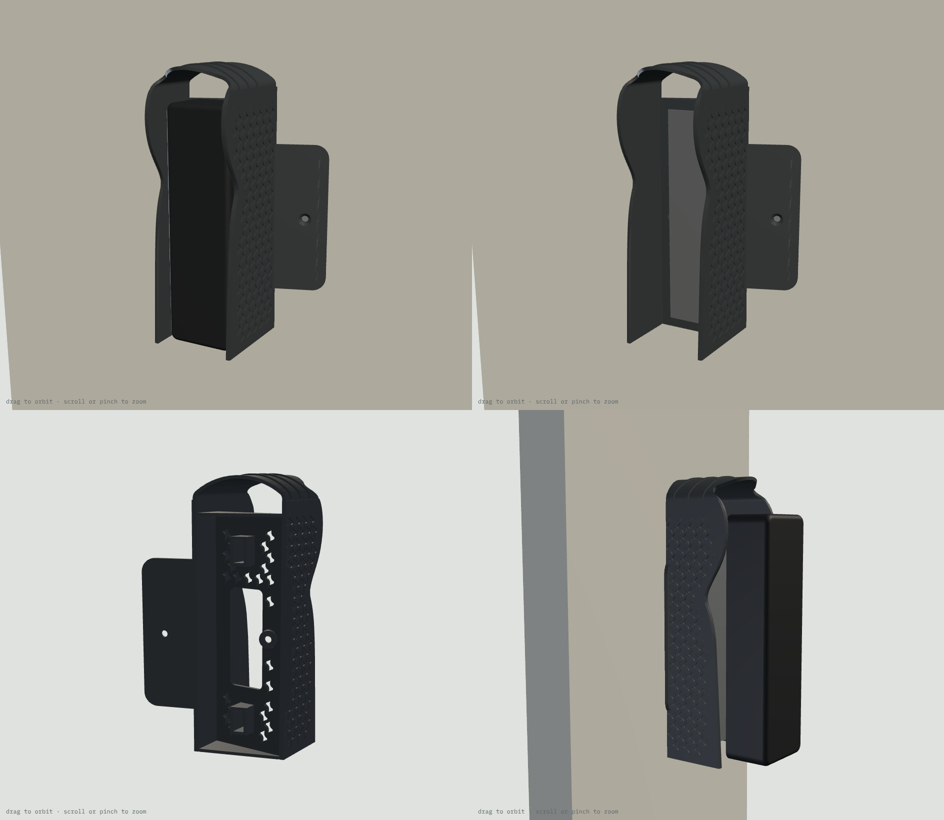

# Doorbell Lite sunshade v5: print list (one piece, over the switch box)

**One printed part that does three jobs: the v4 car-shade sunshade, the doorbell's 20° wedge, and a cover for the Qatar / UK square switch box (BS 4662) in the wall.** For a Ubiquiti UniFi Protect Doorbell Lite on a wall facing 150° in Doha, turned 20° to the left (as you face the wall) toward the entrance.

- **57.2 g.** v4 alone was 70.7 g and v4 plus the separate adapter was 134 g.
- It screws to the box with the box's own two screws. No wall plugs, no adapter, and the doorbell sits flush on the wall as before.
- It shades exactly like v4, because the outer shape and the lip are the same. On June 21 sun on the doorbell drops from 15.0 to 0.2 Wh/day, and it covers 0% of the camera picture.

## What changed from v4

| | v4 | v5 |
|---|---|---|
| Parts | sunshade + adapter (2 parts, 134 g) | 1 part, 57.2 g |
| Fixing | 2 wall screws + anchors (or adapter nuts) | the switch box's 2 screws |
| Shell / wedge sides | 2.2 mm shell + 2.2 mm wedge wall beside it | 1.8 mm shell, which is also the wedge's side wall |
| Seat skin | 2.4 mm | 2.0 mm, S-diamond windows under the doorbell |
| Lattice relief | 0.9 mm | 0.6 mm |
| Doorbell position | wherever the wall holes were | 17 mm to one side of the box centre |

**Why the doorbell sits 17 mm to one side:** the box screws are 60.3 mm apart, and the shade is wider than that, so in one piece it would sit over both screws. Shifted 17 mm:
- one screw (**hidden**) lands inside the wedge. You drive it through a Ø7.5 hole in the seat before the metal plate goes on, and the plate and doorbell then hide it;
- the other screw (**visible**) lands on a flat cover "ear" beside the shade, countersunk flush.

## Parts

| File | Qty | Resin | Purpose |
|---|---|---|---|
| `sunshade_hood_v5_TR300.stl` | 1 | Phrozen TR300 | Sunshade + wedge + box cover. 57.2 g |
| `fit_test_coupon_v5_TR300.stl` | 1 | Phrozen TR300 | Scale frame (62.00 X / 62.00 Y, 56.60 Z), M3 nut channels 5.6 / 5.7 / 5.8, M3 holes 3.3 / 3.4 / 3.5, M3.5 box-screw hole + countersink (3.9 / 7.4). 6.5 g |

STEP files for both are included.

## Orientation and supports

**Part:** the STL is pre-oriented, so don't rotate it. Its print height is 152 mm, the same as v4.
- Long axis 45° from vertical, with the wall side toward the build plate and the roof up.
- The hollow behind the seat opens toward the wall face, and the cable window, seat windows and access hole vent it, so there is no suction cup.
- Down-facing surfaces: 13,311 mm² are at 45° or steeper. The 948 mm² flatter than that are the 0.6 mm ledges of the lattice and ribs, which print without supports, as on v4.
- **Supports** go on the wall-side face only: the wedge's back edge and the back of the cover plate.
- **No supports** on the seat face, in the nut channels, on the lip, on the lattice or on the visible screw's countersink.

**Coupon:** print it axis-aligned and flat, as exported.

## Scale and fits (do this first)

1. Print the coupon and post-process it like the real part.
2. Measure the frame (drawn 62.00 X / 62.00 Y) and the tower (drawn 56.60 Z). Set the slicer scale per axis to drawn ÷ measured × 100 %.
3. Slide an M3 nut through the three channels. The part is drawn at **5.7**. Use the narrowest channel the nut slides through without turning, and tell me if that isn't 5.7.
4. Push an M3 screw through the three holes (the part uses 3.4). Put one of your old switch-plate screws in the box-screw hole: its head should sit flush.

## Post-processing (TR300)

Wash and remove supports. Clear the nut channels, slots, access hole and countersinks with a pick. Cure 15 min dry, no heat.

## Fits

| Feature | Size | Notes |
|---|---|---|
| Box-screw holes | Ø3.9, 90° countersink Ø7.4 on a 3.5 mm boss, 60.3 mm apart | Old M3.5 switch-plate screws |
| Hidden-screw access | Ø7.5 through the seat, on the screw's axis | For the screwdriver; the plate and doorbell cover it |
| Plate-screw slot | 3.4 wide, nominal 46 mm from the middle, travel −1 / +5 mm | Plate holes 90–102 mm apart |
| Nut channel | 5.7 AF, opens toward the wall | The wall holds the nut in, as on v4 |
| Cable window | 22 × 57 mm | Over the box; the plate's Ø18 cable hole falls inside |
| Cover plate | 2.0 mm, 86 × 86 mm round the box | Hides the box opening completely |
| Air gap, sides / top | 2.4 / 18.0 mm (crown) | The doorbell hooks on at up to 20° tilt with a 4 mm lift |

## Hardware by job

| Job | What | Where |
|---|---|---|
| Part to the box | 2 × M3.5 countersunk box screws from the switch plate you take off (25 mm is standard) | Already on the wall |
| Plate to the part | 2 × M3 × 12 mm stainless flat-head (countersunk) Phillips | [Voltaat](https://voltaat.com), 5-pc pack, QAR 1 |
| Nuts for the plate screws | 2 × M3 hex nut | [Voltaat](https://voltaat.com), 5-pc pack, QAR 1 |
| Rain seal (optional) | Clear outdoor silicone | Any hardware shop |
| Tools | Phillips screwdriver, shaft Ø6 or thinner and at least 60 mm long | Al Annabi ([alannabi.qa](https://alannabi.qa)) |

## Assembly

1. Turn off the power to the box. Remove the old switch or blank plate and keep its two screws. If there are loose wires, cap them, or have an electrician do this step.
2. Hold the part wall-side up. Drop an M3 nut into each nut channel, flats along the channel.
3. Feed the PoE cable out of the box through the cable window. Put the part on the wall with the cover "ear" over the side of the box (the ear goes on the thick side of the wedge). The two holes then line up with the box lugs.
4. **Hidden screw first:** push a box screw through the Ø7.5 hole in the seat, then drive it into the lug, reaching through the hole. **Then the visible screw**, through the ear. Tighten both until the heads are flush. Don't overtighten: resin is stiff, not stretchy.
5. Optional: run a thin bead of clear silicone along the top and sides where the part meets the wall. Leave the bottom open.
6. Lay the metal plate on the seat face and line its two end holes up with the slots. Screw in the two M3 × 12 countersunk screws; the nuts slide to meet them.
7. Plug in the doorbell, hook it onto the plate's top tab (tilt the bottom out 10–20°, lift about 4 mm, slide in under the roof), swing the bottom in and fit the lock screw from below.

## Before printing, check two things

1. The plate's end holes should be **90–102 mm** apart, centre to centre (same as v4).
2. The doorbell will sit **17 mm to one side of the box centre**, with the flat ear on the other side. If you'd rather mirror it (ear on the left), tell me before printing.
