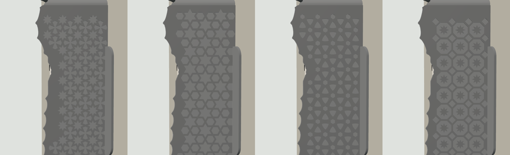

# Doorbell Lite sunshade v5a: print list (one piece, centred on the switch box)

**One printed part, centred on your Qatar / UK square switch box (BS 4662): sunshade, the doorbell's 20° wedge, and a symmetric 86 × 86 mm square that hides the box.** The side walls carry Islamic geometric relief; there are five patterns to choose from. For a white Ubiquiti UniFi Protect Doorbell Lite on a wall facing 150° in Doha, turned 20° to the left (as you face the wall) toward the entrance.

## Two separate joints

| Joint | Held by | Where |
|---|---|---|
| **Part and square to the wall** | The doorbell kit's own 2 screws and plugs | 2 new holes, **60 mm above and 60 mm below the box centre** (120 mm apart, 3 mm to the right of the centre line as you face the wall). The screw heads sit in counterbores in the front face. |
| **Doorbell plate to the part** | 2 × M3 × 12 flat-head screws into 2 **M3 nut pockets** | The pockets are in the wedge, behind the front face. Each is 5.7 mm across flats, 2.6 mm deep, and 12.6 mm long so the nut can slide to wherever your plate's holes are. |

The two joints are independent. You can take the doorbell and its plate off and on without touching the wall fixing. The wall screw heads are under the doorbell, so to reach them you take off the doorbell and the plate.

**Before you drill, check for conduit and cables.** The holes are above and below the switch box, which is where the wiring conduit usually runs. Use a cable and pipe detector, or drill a small pilot hole first.

## Parts

| File | Qty | Resin | Purpose |
|---|---|---|---|
| `sunshade_hood_v5a_TR300.stl` | 1 | Phrozen TR300 | The default design: 8-point star, scalloped edge. 56.9 g |
| `designs/shade_<pattern>_scallop_TR300.stl` | pick 1 | Phrozen TR300 | The same part with another pattern (table below) |
| `fit_test_coupon_v5a_TR300.stl` | 1 | Phrozen TR300 | Scale frame (62.00 X / 62.00 Y, 56.60 Z), M3 nut channels 5.6 / 5.7 / 5.8, M3 holes 3.3 / 3.4 / 3.5. 6.2 g |

STEP files for the default design and the coupon are included.

## Designs

| Pattern | File | Mass | Look |
|---|---|---|---|
| **8-point star** (default) | `shade_khatam_scallop_TR300.stl` | 56.9 g | Eight-pointed stars touching tip to tip, with four-lobed crosses between them |
| 6-point star | `shade_hexstar_scallop_TR300.stl` | 56.2 g | Hexagrams and hexagons, a classic six-fold lattice |
| Rosette | `shade_rosette_scallop_TR300.stl` | 57.5 g | Overlapping circles, leaving petals and curved triangles |
| Octagon and star | `shade_octstar_scallop_TR300.stl` | 56.8 g | Octagons each holding an eight-point star, with small diamonds between |
| Smooth | `shade_smooth_scallop_TR300.stl` | 51.6 g | No pattern; just the scalloped edge |

All five are watertight, one body, no sealed voids, 81.5 × 143.3 × 150.3 mm as printed. Each pattern is a 0.6 mm raised relief on the outside of both side walls, with the same bar width everywhere (1.4 mm). The edge is scalloped: 12 mm arches, 3 mm deep, which only ever shorten the lip, so the camera picture stays clear. Straight-edge versions are available on request.

## Orientation and supports

**Part:** the STL is pre-oriented, so don't rotate it.
- Long axis 45° from vertical, with the wall side toward the build plate and the roof up.
- The hollow behind the front face opens toward the wall side and is vented by the cable window and seat windows, so there is no suction cup.
- The only surfaces flatter than 45° facing down are the 0.6 mm pattern ledges (largest facet 1.7 mm², 435–737 mm² in total depending on the pattern). They print without supports.
- **Supports** go on the wall-side face only.
- **No supports** on the front face (the plate sits on it), in the nut pockets or counterbores, on the lip or on the pattern.

**Coupon:** print it axis-aligned and flat, as exported.

## Scale and fits (do this first)

1. Print the coupon and post-process it like the real part.
2. Measure the frame (drawn 62.00 X / 62.00 Y) and the tower (drawn 56.60 Z). Set the slicer scale per axis to drawn ÷ measured × 100 %.
3. Slide an M3 nut through the three channels. The part is drawn at **5.7**. Use the narrowest channel the nut slides through without turning, and tell me if that isn't 5.7.
4. Push an M3 screw through the three holes (the part uses 3.4).

## Post-processing (TR300)

Wash and remove supports. Clear the nut pockets, slots and counterbores with a pick. Cure 15 min dry, no heat.

## Fits

| Feature | Size | Notes |
|---|---|---|
| Wall-screw counterbore | Ø8.5, 3.0 mm floor | Fits a kit screw head up to 8 mm |
| Wall-screw hole | Ø4.2 | Fits a shank up to 4 mm (M4 or #8) |
| M3 nut pocket | 5.7 AF × 2.6 deep × 12.6 long, open to the wall side | The nut can't turn; the wall keeps it in |
| M3 screw slot | 3.4 wide × 9.4 long, through the 2.2 mm front skin | Plate holes 90–102 mm apart |
| Cable window | 24 × 57 mm | Over the box; the plate's Ø18 cable hole falls inside |
| Square | 2.0 mm, 86 × 86 mm, centred on the box | Hides the box opening |
| Air gap, sides / top | 2.4 / 18.0 mm | The doorbell hooks on at up to 20° tilt with a 4 mm lift |

## Sun on the doorbell (Doha, 150° wall, camera at 170°), Wh/day

| Date | No shade | v4 | **v5a** |
|---|---|---|---|
| Jun 21 | 15.0 | 0.2 | **0.3** |
| May 1 / Aug 12 | 19.4 | 2.9 | **3.6** |
| Mar 21 / Sep 23 | 28.6 | 11.7 | **12.9** |
| Feb 5 / Nov 6 | 36.4 | 20.9 | **22.2** |
| Dec 21 | 37.6 | 23.6 | **24.9** |

The scalloped edge gives up a little shade against v4 (about 0.1 Wh in summer, 1 Wh in winter). The pattern has no effect. The shade covers 0% of the camera picture.

## Hardware by job

| Job | What | Where |
|---|---|---|
| Part to the wall | The doorbell kit's 2 screws and plugs | In the doorbell box |
| Plate to the part | 2 × M3 × 12 mm stainless flat-head (countersunk) Phillips | [Voltaat](https://voltaat.com), 5-pc pack, QAR 1 |
| Nuts | 2 × M3 hex nut | [Voltaat](https://voltaat.com), 5-pc pack, QAR 1 |
| Tools | Drill and masonry bit to suit the plugs, Phillips screwdriver with a shaft Ø6 or thinner, painter's tape | |

## Assembly

1. Turn off the power to the box. Remove the old switch or blank plate. If there are loose wires, cap them, or have an electrician do this step.
2. Hold the part against the wall, centred on the box (the square's edges line up with the box) and level. Mark the wall through the two Ø4.2 holes. Take the part away, check for conduit, drill, and push in the plugs.
3. Lay the part wall-side up. Drop an M3 nut into each nut pocket, flats along the pocket. Put a strip of painter's tape across each pocket mouth so the nuts stay in while you turn the part over.
4. Feed the PoE cable out of the box through the cable window and put the part on the wall. Drive the two kit screws through the counterbores into the plugs. Peel off the tape.
5. Optional: run a thin bead of clear silicone along the top and sides where the part meets the wall. Leave the bottom open.
6. Lay the metal plate on the front face and line its two end holes up with the slots. Screw in the two M3 × 12 screws. If a nut doesn't line up, nudge it along its pocket with a pick.
7. Plug in the doorbell, hook it onto the plate's top tab (tilt the bottom out 10–20°, lift about 4 mm, slide in under the roof), swing the bottom in and fit the lock screw from below.

## Before printing, check two things

1. The plate's end holes should be **90–102 mm** apart, centre to centre.
2. The size of the kit's wall screws. The counterbore takes a head up to 8 mm and the hole a shank up to 4 mm. If yours are bigger, tell me.
