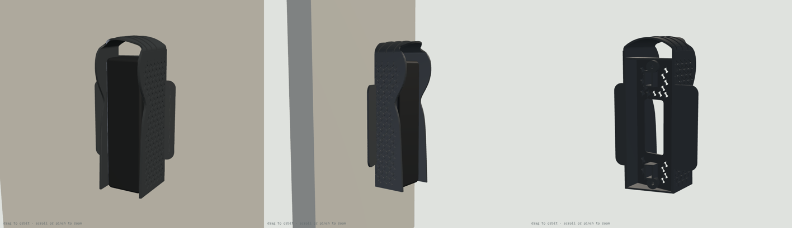

# Doorbell Lite sunshade v5a: print list (one piece, centred on the switch box)

**One printed part, centred on your Qatar / UK square switch box (BS 4662): the v4 car-shade sunshade, the doorbell's 20° wedge, and a symmetric 86 × 86 mm backplate that hides the box.** For a Ubiquiti UniFi Protect Doorbell Lite on a wall facing 150° in Doha, turned 20° to the left (as you face the wall) toward the entrance.

- **58.0 g.** v4 alone was 70.7 g, and v4 plus the separate adapter was 134 g.
- **Centred:** the shade's front view is centred on the box, with the same 86 mm square behind it on both sides.
- **Same shade as v4:** same outer shape and lip. Sun on the doorbell drops from 15.0 to 0.2 Wh/day on June 21, and it covers 0% of the camera picture.
- **Fixing:** the shade sits right over the box's two screw lugs, so they can't be used. It's held like v4, by the doorbell kit's two M3 screws and wall plugs, in **two new holes 120 mm apart: 60 mm above and 60 mm below the box centre, 3 mm to the right of it** (as you face the wall). The metal plate and doorbell hide both screws. The part is its own drilling template.

## Parts

| File | Qty | Resin | Purpose |
|---|---|---|---|
| `sunshade_hood_v5a_TR300.stl` | 1 | Phrozen TR300 | Sunshade + wedge + box backplate. 58.0 g |
| `fit_test_coupon_v5a_TR300.stl` | 1 | Phrozen TR300 | Scale frame (62.00 X / 62.00 Y, 56.60 Z), M3 nut channels 5.6 / 5.7 / 5.8, M3 holes 3.3 / 3.4 / 3.5. 6.5 g |

STEP files for both are included.

## Sun on the doorbell (Doha, 150° wall, camera at 170°), Wh/day

| Date | No shade | v4 | this part | B |
|---|---|---|---|---|
| Jun 21 | 15.0 | 0.2 | **0.2** | 0.5 |
| May 1 / Aug 12 | 19.4 | 2.9 | **3.0** | 5.8 |
| Mar 21 / Sep 23 | 28.6 | 11.7 | **11.8** | 17.7 |
| Feb 5 / Nov 6 | 36.4 | 20.9 | **21.1** | 26.3 |
| Dec 21 | 37.6 | 23.6 | **23.8** | 27.6 |

## Orientation and supports

**Part:** the STL is pre-oriented, so don't rotate it. It prints 81.5 × 144.8 × 152.0 mm.
- Long axis 45° from vertical, with the wall side toward the build plate and the roof up.
- The hollow behind the seat opens toward the wall side and is vented through the cable and seat windows, so there is no suction cup.
- Down-facing surfaces flatter than 45° total 993 mm². They are the 0.6 mm ledges of the lattice and ribs (largest facet under 2 mm²), which print without supports, as on v4.
- **Supports** go on the wall-side face only.
- **No supports** on the seat face, in the nut channels or countersinks, on the lip or on the lattice.

**Coupon:** print it axis-aligned and flat, as exported.

## Scale and fits (do this first)

1. Print the coupon and post-process it like the real part.
2. Measure the frame (drawn 62.00 X / 62.00 Y) and the tower (drawn 56.60 Z). Set the slicer scale per axis to drawn ÷ measured × 100 %.
3. Slide an M3 nut through the three channels. The part is drawn at **5.7**. Use the narrowest channel the nut slides through without turning, and tell me if that isn't 5.7.
4. Push an M3 screw through the three holes (the part uses 3.4).

## Post-processing (TR300)

Wash and remove supports. Clear the nut channels, slots, counterbores and holes with a pick. Cure 15 min dry, no heat.

## Fits

| Feature | Size | Notes |
|---|---|---|
| Wall-screw counterbores | Ø7.5, 3.0 mm floor, Ø3.4 hole, square to the wall, 120 mm apart | New holes, 60 mm above and below the box centre |
| Plate-screw slot | 3.4 wide, 46 mm from the middle, travel −1 / +5 mm | Plate holes 90–102 mm apart |
| Nut channel | 5.7 AF, opens toward the wall | The wall holds the nut in |
| Cable window | 24 × 57 mm | Over the box |
| Backplate | 2.0 mm, 86 × 86 mm, centred on the box | Hides the box |
| Air gap, sides / top | 2.4 / 18.0 mm | Hook-on at up to 20° tilt with a 4 mm lift |

## Hardware by job

| Job | What | Where |
|---|---|---|
| Part to the wall | The doorbell kit's 2 × M3 wall screws and plugs (or any 2 × M3 × 25–30 + 5 mm plugs) | Doorbell box |
| Plate to the part | 2 × M3 × 12 mm stainless flat-head (countersunk) Phillips | [Voltaat](https://voltaat.com), 5-pc pack, QAR 1 |
| Nuts for the plate screws | 2 × M3 hex nut | [Voltaat](https://voltaat.com), 5-pc pack, QAR 1 |
| Tools | Drill and 5 mm masonry bit, Phillips screwdriver | |

## Assembly

1. Turn off the power to the box. Remove the old switch or blank plate. If there are loose wires, cap them, or have an electrician do this step.
2. Hold the part on the wall, centred on the box (the backplate's square edges line up with the box), and level it. Mark the wall through the two small holes at the bottom of the counterbores. Drill them and push in the plugs.
3. Hold the part wall-side up. Drop an M3 nut into each nut channel, flats along the channel.
4. Feed the PoE cable out of the box through the cable window. Put the part on the wall and drive the two wall screws through the counterbores into the plugs.
5. Optional: run a thin bead of clear silicone along the top and sides where the part meets the wall. Leave the bottom open.
6. Lay the metal plate on the seat face and line its end holes up with the slots. Screw in the two M3 × 12; the nuts slide to meet them.
7. Plug in the doorbell, hook it onto the plate's top tab (tilt the bottom out 10–20°, lift about 4 mm, slide in under the roof), swing the bottom in and fit the lock screw from below.

## Before printing, check one thing

The plate's end holes should be **90–102 mm** apart, centre to centre (same as v4).
