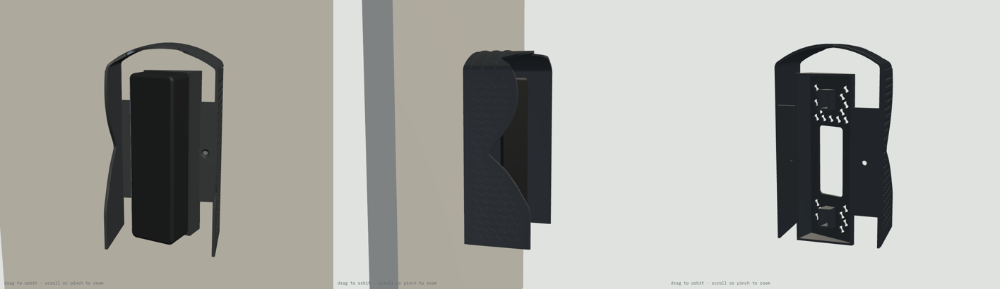

# Doorbell Lite sunshade v5b: print list (one piece, shade the width of the switch box)

**One printed part with the sunshade redesigned to the size of your Qatar / UK square switch box (BS 4662): an 86 mm wide hood, a switch plate's width, centred on the box, with the doorbell's 20° wedge and a box cover inside it.** For a Ubiquiti UniFi Protect Doorbell Lite on a wall facing 150° in Doha, turned 20° to the left toward the entrance.

- **70.0 g.**
- **Centred, no drilling:** the hood's side walls are square to the wall, 86 mm apart, so both of the box's own screws sit inside the hood beside the wedge. You screw them in before the doorbell goes on.
- **Looks bigger, shades less than A/v4:** the gaps beside the doorbell are 10–16 mm, so low sun from the side gets in. In midsummer it still cuts 96% (15.0 → 0.5 Wh/day on June 21), but spring and autumn let in about 1.5× what A does (see the table). It covers 0% of the camera picture.

## Parts

| File | Qty | Resin | Purpose |
|---|---|---|---|
| `sunshade_hood_v5b_TR300.stl` | 1 | Phrozen TR300 | Box-sized hood + wedge + box cover. 70.0 g |
| `fit_test_coupon_v5b_TR300.stl` | 1 | Phrozen TR300 | Scale frame (62.00 X / 62.00 Y, 56.60 Z), M3 nut channels 5.6 / 5.7 / 5.8, M3 holes 3.3 / 3.4 / 3.5, M3.5 box-screw hole + countersink (3.9 / 7.4). 6.5 g |

STEP files for both are included.

## Sun on the doorbell (Doha, 150° wall, camera at 170°), Wh/day

| Date | No shade | v4 | this part | A |
|---|---|---|---|---|
| Jun 21 | 15.0 | 0.2 | **0.5** | 0.2 |
| May 1 / Aug 12 | 19.4 | 2.9 | **5.8** | 3.0 |
| Mar 21 / Sep 23 | 28.6 | 11.7 | **17.7** | 11.8 |
| Feb 5 / Nov 6 | 36.4 | 20.9 | **26.3** | 21.1 |
| Dec 21 | 37.6 | 23.6 | **27.6** | 23.8 |

## Orientation and supports

**Part:** the STL is pre-oriented, so don't rotate it. It prints 87.8 × 151.4 × 148.7 mm.
- Long axis 45° from vertical, with the wall side toward the build plate and the roof up.
- The hollow behind the seat opens toward the wall side and is vented through the cable and seat windows, so there is no suction cup.
- Down-facing surfaces flatter than 45° total 1,024 mm². They are the 0.6 mm ledges of the lattice and ribs (largest facet under 2 mm²), which print without supports, as on v4.
- **Supports** go on the wall-side face only.
- **No supports** on the seat face, in the nut channels or countersinks, on the lip or on the lattice.

**Coupon:** print it axis-aligned and flat, as exported.

## Scale and fits (do this first)

1. Print the coupon and post-process it like the real part.
2. Measure the frame (drawn 62.00 X / 62.00 Y) and the tower (drawn 56.60 Z). Set the slicer scale per axis to drawn ÷ measured × 100 %.
3. Slide an M3 nut through the three channels. The part is drawn at **5.7**. Use the narrowest channel the nut slides through without turning, and tell me if that isn't 5.7.
4. Push an M3 screw through the three holes (the part uses 3.4). Put one of your old switch-plate screws in the box-screw hole: its head should sit flush.

## Post-processing (TR300)

Wash and remove supports. Clear the nut channels, slots, counterbores and holes with a pick. Cure 15 min dry, no heat.

## Fits

| Feature | Size | Notes |
|---|---|---|
| Box-screw holes | Ø3.9, 90° countersink Ø7.4 on a 3.5 mm boss, 60.3 mm apart | Old M3.5 switch-plate screws, inside the hood |
| Plate-screw slot | 3.4 wide, 46 mm from the middle, travel −1 / +5 mm | Plate holes 90–102 mm apart |
| Nut channel | 5.7 AF, opens toward the wall | The wall holds the nut in |
| Cable window | 24 × 57 mm | Over the box |
| Box cover | 2.0 mm, 86 × 86 mm inside the hood | Hides the box |
| Hood | 86 mm wide outside, side walls square to the wall, vault crown 20 mm above the doorbell | Hook-on at up to 20° tilt with a 4 mm lift |

## Hardware by job

| Job | What | Where |
|---|---|---|
| Part to the box | 2 × M3.5 countersunk box screws from the switch plate you take off (25 mm is standard) | Already on the wall |
| Plate to the part | 2 × M3 × 12 mm stainless flat-head (countersunk) Phillips | [Voltaat](https://voltaat.com), 5-pc pack, QAR 1 |
| Nuts for the plate screws | 2 × M3 hex nut | [Voltaat](https://voltaat.com), 5-pc pack, QAR 1 |
| Tools | Phillips screwdriver, shaft Ø6 or thinner and at least 60 mm long | Al Annabi ([alannabi.qa](https://alannabi.qa)) |

## Assembly

1. Turn off the power to the box. Remove the old switch or blank plate and keep its two screws. If there are loose wires, cap them, or have an electrician do this step.
2. Hold the part wall-side up. Drop an M3 nut into each nut channel, flats along the channel.
3. Feed the PoE cable out of the box through the cable window and put the part on the wall, square over the box.
4. Drive the two box screws through the holes beside the wedge into the box lugs until the heads are flush. Don't overtighten: resin is stiff, not stretchy.
5. Optional: run a thin bead of clear silicone along the top and sides where the part meets the wall. Leave the bottom open.
6. Lay the metal plate on the seat face and line its end holes up with the slots. Screw in the two M3 × 12; the nuts slide to meet them.
7. Plug in the doorbell, hook it onto the plate's top tab (tilt the bottom out 10–20°, lift about 4 mm, slide in under the roof), swing the bottom in and fit the lock screw from below.

## Before printing, check one thing

The plate's end holes should be **90–102 mm** apart, centre to centre (same as v4).
