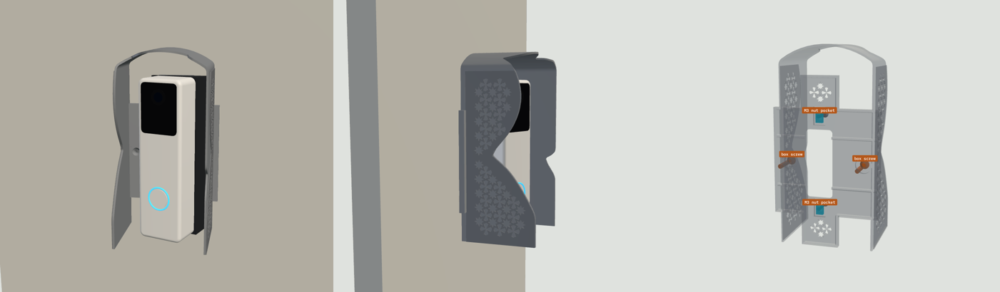
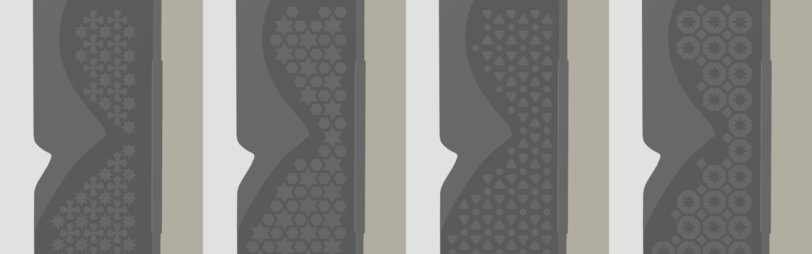

# Doorbell Lite sunshade v6: print list (straight shade, your own angled bracket)

**A straight, symmetric shade centred on your Qatar / UK square switch box (BS 4662). From afar it is square to the wall and looks flat. Up close, the doorbell sits inside it, angled, on your own angled bracket.** There is no wedge in the printed part. The side walls carry Islamic geometric relief, and there are five patterns to choose from. For a white Ubiquiti UniFi Protect Doorbell Lite on a wall facing 150° in Doha, turned 20° to the left (as you face the wall) toward the entrance.

## Two separate joints

| Joint | Held by | Where |
|---|---|---|
| **Shade to the wall** | The switch box's own 2 screws (the ones from the old switch plate) | The box's screw lugs, **left and right of the box**, 60.3 mm apart. Countersunk flush in a 4.8 mm backplate. **No drilling.** |
| **Your angled bracket to the shade** | 2 × M3 bolts into 2 **M3 nut pockets** | Behind the backplate's front face, **74 mm apart** on the bracket's centre line. Each pocket is 5.7 mm across flats, 2.8 mm deep, and 10.4 mm long, so the nut can slide 4 mm to meet the bolt. |

The two joints are independent. The doorbell and bracket come off without touching the wall fixing. The hood's side walls stand 76 mm apart, outside both box screws, so a screwdriver reaches them along the wall normal before the bracket goes on.

## What's in the part

- **Hood:** 76 mm wide, straight sides, barrel-vault roof, 1.6 mm shell, reaching up to 64 mm from the wall. The edge is cut just outside the camera's picture (3° margin plus 1.6 mm), so it never shows in the video.
- **Backplate:** an 86 × 86 mm square that hides the box, plus a 30 mm spine up and down your bracket's centre line, 4.8 mm thick, hollow behind (2.0 mm front skin). Your bracket's flat back sits on its front face. Star openwork lightens it wherever the box opening isn't behind it.
- **Cable window:** 22 × 55 mm, over the box. The doorbell plate's Ø18 cable hole falls inside it.
- **Position:** the hood is centred on the box. Your bracket's centre line (and the nut pockets) are **5.3 mm to the right of the box centre, as you face the wall**. That is what centres the angled doorbell inside the hood.

## Parts

| File | Qty | Resin | Purpose |
|---|---|---|---|
| `sunshade_hood_v6_TR300.stl` | 1 | Phrozen TR300 | The default design: 8-point star. 67.1 g |
| `designs/shade_<pattern>_TR300.stl` | pick 1 | Phrozen TR300 | The same part with another pattern (table below) |
| `fit_test_coupon_v6_TR300.stl` | 1 | Phrozen TR300 | Scale frame (62.00 X / 62.00 Y, 56.60 Z), M3 nut channels 5.6 / 5.7 / 5.8, M3 holes 3.3 / 3.4 / 3.5. 6.2 g |

STEP files for the default design and the coupon are included.

## Designs

| Pattern | File | Mass | Look |
|---|---|---|---|
| **8-point star** (default) | `shade_khatam_TR300.stl` | 67.1 g | Eight-pointed stars touching tip to tip, with four-lobed crosses between them |
| 6-point star | `shade_hexstar_TR300.stl` | 65.9 g | Hexagrams and hexagons, a classic six-fold lattice |
| Rosette | `shade_rosette_TR300.stl` | 67.2 g | Overlapping circles, leaving petals and curved triangles |
| Octagon and star | `shade_octstar_TR300.stl` | 66.1 g | Octagons each holding an eight-point star, with small diamonds between |
| Smooth | `shade_smooth_TR300.stl` | 60.5 g | No pattern |

All five are watertight, one body, no sealed voids, 86 × 159 × 154 mm as printed. Each pattern is a 0.6 mm raised relief on the outside of both side walls, with the same bar width everywhere (1.4 mm).

## Orientation and supports

**Part:** the STL is pre-oriented, so don't rotate it.
- Long axis 45° from vertical, with the wall side toward the build plate and the roof up.
- The hollow behind the backplate opens toward the wall side and is vented by the cable window, the nut-pocket slots and the star openwork, so there is no suction cup.
- The only surfaces flatter than 45° facing down are the 0.6 mm pattern ledges (largest facet 1.5 mm², 369–593 mm² in total depending on the pattern). They print without supports.
- **Supports** go on the wall-side face only (the backplate's back and the hood's back edge).
- **No supports** on the front face (your bracket sits on it), in the nut pockets or countersinks, on the lip or on the pattern.

**Coupon:** print it axis-aligned and flat, as exported.

## Scale and fits (do this first)

1. Print the coupon and post-process it like the real part.
2. Measure the frame (drawn 62.00 X / 62.00 Y) and the tower (drawn 56.60 Z). Set the slicer scale per axis to drawn ÷ measured × 100 %.
3. Slide an M3 nut through the three channels. The part is drawn at **5.7**. Use the narrowest channel the nut slides through without turning, and tell me if that isn't 5.7.
4. Push an M3 screw through the three holes (the part uses 3.4).

## Post-processing (TR300)

Wash and remove supports. Clear the nut pockets, slots and countersinks with a pick. Cure 15 min dry, no heat.

## Fits

| Feature | Size | Notes |
|---|---|---|
| Box-screw holes | Ø3.9, 90° countersink Ø7.4, 60.3 mm apart on the box's centre line | The old switch-plate screws; the heads end flush |
| M3 nut pocket | 5.7 AF × 2.8 deep × 10.4 long, open to the wall side | The nut can't turn; the wall keeps it in |
| M3 bolt slot | 3.4 wide × 7.4 long, through the 2.0 mm front skin | 74 mm apart, 5.3 mm right of the box centre |
| Cable window | 22 × 55 mm | Over the box |
| Backplate | 4.8 mm thick, 86 × 86 mm plus a 30 mm spine | Your bracket's flat back sits on it |
| Hood | 76 mm wide, 1.6 mm walls, up to 64 mm deep | 3.5 mm minimum gap to the doorbell |

## Sun on the doorbell (Doha, 150° wall, camera at 170°), Wh/day

| Date | No shade | v4 | **v6** |
|---|---|---|---|
| Jun 21 | 15.0 | 0.2 | **0.1** |
| May 1 / Aug 12 | 19.4 | 2.9 | **3.5** |
| Mar 21 / Sep 23 | 28.6 | 11.7 | **14.6** |
| Feb 5 / Nov 6 | 36.4 | 20.9 | **24.4** |
| Dec 21 | 37.6 | 23.6 | **26.7** |

The deeper hood matches v4 in midsummer. In the other months it lets in a little more low side sun, because the walls stand 11–13 mm away from the doorbell on each side (they have to clear the box screws). The pattern has no effect. The shade covers 0% of the camera picture.

## Hardware by job

| Job | What | Where |
|---|---|---|
| Shade to the wall | The 2 screws from the old switch plate (M3.5, usually 25 mm) | Already on the wall |
| Bracket to the shade | 2 × M3 flat-head (countersunk) bolts. Length = your bracket's thickness at the hole + 4.4 mm (2.0 skin + 2.4 nut), +1 mm. For a bracket 11 mm thick at its centre line that is **M3 × 16**. | [Voltaat](https://voltaat.com), 5-pc packs, QAR 1 |
| Nuts | 2 × M3 hex nut | [Voltaat](https://voltaat.com), 5-pc pack, QAR 1 |
| Tools | Phillips screwdriver with a shaft Ø6 or thinner and at least 80 mm long, painter's tape | Al Annabi ([alannabi.qa](https://alannabi.qa)) |

Don't use bolts longer than that: the pockets open to the wall, so a long bolt would push against the wall behind.

## Assembly

1. Turn off the power to the box. Remove the old switch or blank plate and keep its two screws. If there are loose wires, cap them, or have an electrician do this step.
2. Lay the part wall-side up. Drop an M3 nut into each nut pocket, flats along the pocket. Put a strip of painter's tape across each pocket mouth so the nuts stay in while you turn the part over.
3. Feed the PoE cable out of the box through the cable window and put the part on the wall, square over the box (the square's edges line up with the box, the hood stands straight out).
4. Drive the two box screws through the left and right countersunk holes into the box lugs, with the screwdriver reaching in through the open front of the hood. Tighten until the heads are flush. Don't overtighten: resin is stiff, not stretchy. Peel off the tape.
5. Optional: run a thin bead of clear silicone along the top and sides where the square meets the wall. Leave the bottom open.
6. Lay your angled bracket on the front face with its two wall-screw holes over the slots, 5.3 mm right of the shade's centre line. Bolt it on with the two M3 bolts. If a nut doesn't line up, nudge it along its pocket with a pick.
7. Fit the metal plate and doorbell on the bracket as usual: plug in, hook onto the plate's top tab (tilt the bottom out 10–20°, lift about 4 mm, slide in under the roof), swing the bottom in and fit the lock screw from below.

## Before printing, check three things

1. Your bracket's two wall-screw holes should be **74 mm** apart, centred on it. If not, tell me the spacing.
2. The bracket's thickness at its thin and thick edges. I assumed **3 mm** and **19 mm** (11 mm on its centre line), copied from the repo's wedge model. If yours is thicker, the doorbell sits further out, and I'll shorten the hood's edge to keep it out of the picture.
3. The bracket's footprint: I assumed 44 mm wide and 137 mm tall.
