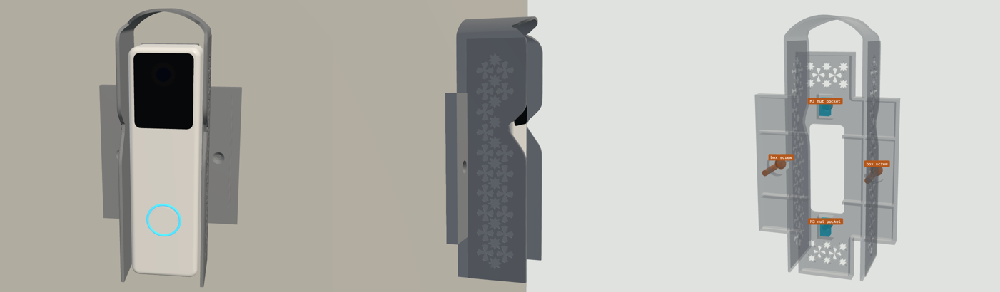
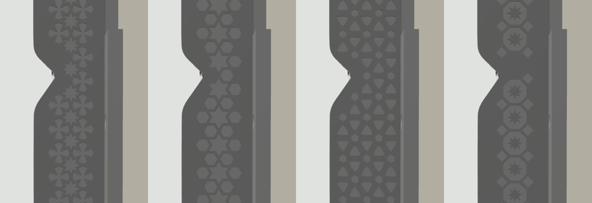

# Doorbell Lite sunshade v7: print list (simple, small, no angle)

**A small shade, centred on your Qatar / UK square switch box (BS 4662). The doorbell sits flat on the wall with no angle, and its own metal plate bolts straight onto the part.** The shade hugs the doorbell, so it is only 48 mm wide. The side walls carry Islamic geometric relief, and there are five patterns to choose from. For a white Ubiquiti UniFi Protect Doorbell Lite on a wall facing 150° in Doha.

## Two separate joints

| Joint | Held by | Where |
|---|---|---|
| **Part to the wall** | The switch box's own 2 screws (the ones from the old switch plate) | The box's screw lugs, **left and right of the box**, 60.3 mm apart. Countersunk flush in the 86 × 86 mm backplate, outside the shade's walls. **No drilling.** |
| **Doorbell plate to the part** | 2 × M3 × 8 bolts into 2 **M3 nut pockets** | Behind the backplate's front face, **74 mm apart**, on the doorbell's centre line. Each pocket is 5.7 mm across flats, 4.8 mm deep, and 10.4 mm long, so the nut can slide 4 mm to meet the bolt. |

The two joints are independent. The doorbell and its plate come off without touching the wall fixing.

## What's in the part

- **Shade:** 48 mm wide, 1.6 mm walls, straight sides, barrel-vault roof, reaching up to 42 mm from the wall (about 14 mm past the doorbell's front). The edge is cut just outside the camera's picture (3° margin plus 1.6 mm), so it never shows in the video.
- **Backplate:** an 86 × 86 mm square that hides the box, plus a 34 mm spine the doorbell's full height under the plate, 6.8 mm thick, hollow behind (2.0 mm front skin). The thickness gives the nuts room, so M3 × 8 bolts reach them and stop above the wall. Star openwork lightens it wherever the box opening isn't behind it.
- **Cable window:** 22 × 55 mm, over the box. The doorbell plate's Ø18 cable hole falls inside it.
- **Position:** everything is centred on the box: the shade, the doorbell and the nut pockets.

## Parts

| File | Qty | Resin | Purpose |
|---|---|---|---|
| `sunshade_hood_v7_TR300.stl` | 1 | Phrozen TR300 | The default design: 8-point star. 56.7 g |
| `designs/shade_<pattern>_TR300.stl` | pick 1 | Phrozen TR300 | The same part with another pattern (table below) |
| `fit_test_coupon_v7_TR300.stl` | 1 | Phrozen TR300 | Scale frame (62.00 X / 62.00 Y, 56.60 Z), M3 nut channels 5.6 / 5.7 / 5.8, M3 holes 3.3 / 3.4 / 3.5. 6.2 g |

STEP files for the default design and the coupon are included.

## Designs

| Pattern | File | Mass | Look |
|---|---|---|---|
| **8-point star** (default) | `shade_khatam_TR300.stl` | 56.7 g | Eight-pointed stars touching tip to tip, with four-lobed crosses between them |
| 6-point star | `shade_hexstar_TR300.stl` | 56.4 g | Hexagrams and hexagons, a classic six-fold lattice |
| Rosette | `shade_rosette_TR300.stl` | 56.6 g | Overlapping circles, leaving petals and curved triangles |
| Octagon and star | `shade_octstar_TR300.stl` | 57.0 g | Octagons each holding an eight-point star, with small diamonds between |
| Smooth | `shade_smooth_TR300.stl` | 51.5 g | No pattern |

All five are watertight, one body, no sealed voids, 86 × 141 × 141 mm as printed. Each pattern is a 0.6 mm raised relief on the outside of both side walls, with the same bar width everywhere (1.4 mm). The walls are narrow, so you get one or two columns of the pattern.

## Orientation and supports

**Part:** the STL is pre-oriented, so don't rotate it.
- Long axis 45° from vertical, with the wall side toward the build plate and the roof up.
- The hollow behind the backplate opens toward the wall side and is vented by the cable window, the nut-pocket slots and the star openwork, so there is no suction cup.
- The only surfaces flatter than 45° facing down are the 0.6 mm pattern ledges (largest facet 1.4 mm², 206–395 mm² in total depending on the pattern). They print without supports.
- **Supports** go on the wall-side face only (the backplate's back and the shade's back edge).
- **No supports** on the front face (the doorbell plate sits on it), in the nut pockets or countersinks, on the edge or on the pattern.

**Coupon:** print it axis-aligned and flat, as exported.

## Scale and fits (do this first)

1. Print the coupon and post-process it like the real part.
2. Measure the frame (drawn 62.00 X / 62.00 Y) and the tower (drawn 56.60 Z). Set the slicer scale per axis to drawn ÷ measured × 100 %.
3. Slide an M3 nut through the three channels. The part is drawn at **5.7**. Use the narrowest channel the nut slides through without turning, and tell me if that isn't 5.7.
4. Push an M3 screw through the three holes (the part uses 3.4).

## Post-processing (TR300)

Wash and remove supports. Clear the nut pockets, slots and countersinks with a pick. Cure 15 min dry, no heat.

## Fits

| Feature | Size | Notes |
|---|---|---|
| Box-screw holes | Ø3.9, 90° countersink Ø7.4, 60.3 mm apart on the box's centre line | The old switch-plate screws; the heads end flush |
| M3 nut pocket | 5.7 AF × 4.8 deep × 10.4 long, open to the wall side | The nut can't turn; the wall keeps it in |
| M3 bolt slot | 3.4 wide × 7.4 long, through the 2.0 mm front skin | 74 mm apart, on the centre line |
| Cable window | 22 × 55 mm | Over the box |
| Backplate | 6.8 mm thick, 86 × 86 mm plus a 34 mm spine | The doorbell's plate sits on it |
| Shade | 48 mm wide, 1.6 mm walls, up to 42 mm deep | 2.4 mm gap each side of the doorbell, 19 mm above it |

## Sun on the doorbell (Doha, wall and camera facing 150°), Wh/day

| Date | No shade | **v7** | Cut |
|---|---|---|---|
| Jun 21 | 18.7 | **2.4** | 87% |
| May 1 / Aug 12 | 22.4 | **6.7** | 70% |
| Mar 21 / Sep 23 | 29.1 | **13.9** | 52% |
| Feb 5 / Nov 6 | 34.6 | **19.4** | 44% |
| Dec 21 | 35.4 | **20.5** | 42% |

The doorbell faces straight out, so it gets more low morning sun than the angled versions, where turning the doorbell away from the sun does part of the work. The shade covers 0% of the camera picture. The pattern has no effect.

## Hardware by job

| Job | What | Where |
|---|---|---|
| Part to the wall | The 2 screws from the old switch plate (M3.5, usually 25 mm) | Already on the wall |
| Doorbell plate to the part | 2 × **M3 × 8** mm flat-head (countersunk) stainless Phillips | [Voltaat](https://voltaat.com), 5-pc pack, QAR 1 |
| Nuts | 2 × M3 hex nut | [Voltaat](https://voltaat.com), 5-pc pack, QAR 1 |
| Tools | Phillips screwdriver with a shaft Ø6 or thinner and at least 60 mm long, painter's tape | Al Annabi ([alannabi.qa](https://alannabi.qa)) |

Don't use bolts longer than 8 mm: the pockets open to the wall, so a longer bolt would push against the wall behind.

## Assembly

1. Turn off the power to the box. Remove the old switch or blank plate and keep its two screws. If there are loose wires, cap them, or have an electrician do this step.
2. Lay the part wall-side up. Drop an M3 nut into each nut pocket, flats along the pocket. Put a strip of painter's tape across each pocket mouth so the nuts stay in while you turn the part over.
3. Feed the PoE cable out of the box through the cable window and put the part on the wall, square over the box (the square's edges line up with the box, the shade stands straight out).
4. Drive the two box screws through the left and right countersunk holes into the box lugs, outside the shade's walls. Tighten until the heads are flush. Don't overtighten: resin is stiff, not stretchy. Peel off the tape.
5. Optional: run a thin bead of clear silicone along the top and sides where the square meets the wall. Leave the bottom open.
6. Lay the doorbell's metal plate on the front face with its two end holes over the slots. Screw in the two M3 × 8 bolts. If a nut doesn't line up, nudge it along its pocket with a pick.
7. Plug in the doorbell, hook it onto the plate's top tab (tilt the bottom out 10–20°, lift about 4 mm, slide in under the roof), swing the bottom in and fit the lock screw from below.

## Before printing, check one thing

The plate's two end holes should be **74 mm** apart, centre to centre, on its centre line. This comes from Ubiquiti's to-scale drawing. If yours differ, tell me the spacing and I'll move the pockets.
