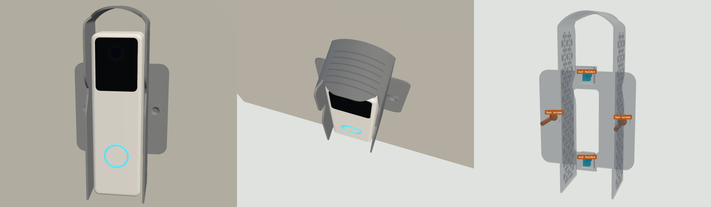
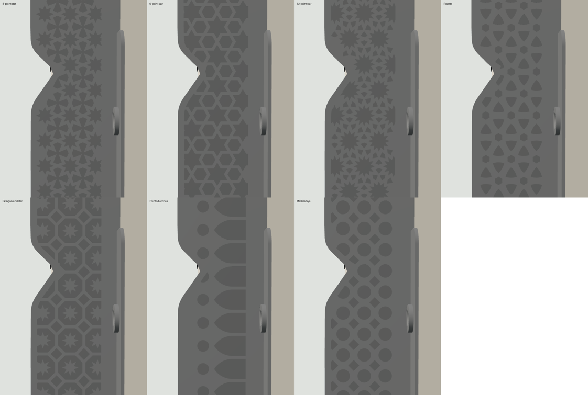

# Doorbell Lite sunshade v9: print list (simple, thin flap, nut holders, full-face patterns, shingle-line roof)

**A small shade, centred on your Qatar / UK square switch box (BS 4662). The doorbell sits flat on the wall with no angle, and its own metal plate bolts onto two nut holders.** The back flap is now thin, so the part uses far less material. The side walls carry Islamic geometric patterns, **engraved** into them and running over the **whole face** of both walls, so a pattern makes the part lighter, not heavier. The roof carries straight **shingle lines** across it, engraved 0.5 mm. For a white Ubiquiti UniFi Protect Doorbell Lite on a wall facing 150° in Doha.

## What changed from v8

| | v8 | v9 |
|---|---|---|
| Pattern coverage | a band down the middle of each side wall | **the whole face** of both side walls: motifs run to the frame and are clipped there |
| Roof | plain | **shingle lines**: six straight lines across it, like the courses of a shingled roof, engraved 0.5 mm |
| Mass, 8-point star | 36.0 g | **34.3 g** |
| Pointed arches | a single row | a row of arches with a small round window above each |

The shade shape, the thin 1.6 mm flap, the nut holders and the mounting are unchanged. (Against v7, with a thick plate and raised patterns, the 8-point star was 56.7 g.)

## Two separate joints

| Joint | Held by | Where |
|---|---|---|
| **Part to the wall** | The switch box's own 2 screws (the ones from the old switch plate) | The box's screw lugs, **left and right of the box**, 60.3 mm apart. Countersunk flush in two 3.6 mm bosses on the flap, outside the shade's walls. **No drilling.** |
| **Doorbell plate to the part** | 2 × M3 × 8 bolts into 2 **nut holders** | Two blocks, 12 × 14 mm, 5.2 mm tall, on the front of the flap, **74 mm apart** on the doorbell's centre line. Each holds an M3 nut in a pocket 5.7 mm across flats under a 2.0 mm top skin, with a 2 mm slide. |

The two joints are independent. The doorbell and its plate come off without touching the wall fixing. The doorbell plate sits on the tops of the two nut holders, 6.8 mm from the wall, exactly where it sat in v7.

**How a nut holder works:** the nut is dropped in from behind through a window in the thin flap and sits against the holder's top skin. When the bolt comes through the plate and the skin, it screws into the nut, and the nut pulls up against the skin. Once the part is on the wall, the wall closes the window behind the nut.

## What's in the part

- **Shade:** 48 mm wide, 1.6 mm walls, straight sides, barrel-vault roof, reaching up to 42 mm from the wall (about 14 mm past the doorbell's front). The roof's shingle lines are six straight lines across the roof, 4.8 mm apart, 0.9 mm wide and 0.5 mm deep, running from one side of the arch to the other. They leave 1.1 mm of roof and stop at least 3 mm back from the roof's edge.
- **Back flap:** 82 × 82 mm, 1.6 mm thick (the box is 75 mm), with two small tabs under the nut holders. It is solid resin. Estimate (not a finite-element run): the doorbell weighs about 0.15 kg and its centre sits about 15 mm out from the wall, so the flap sees a bending moment of roughly 25 N·mm across its 82 mm width at the box screws. That is about 1 MPa, against 60 MPa for TR300 and the repo's 10 MPa working limit. The nut bearing area takes about 7 MPa at a hand-tight 100 N, so tighten the bolts by hand only.
- **Nut holders:** 2, as above.
- **Bosses:** 2 small raised rings round the box screws so the countersinks are deep enough.
- **Cable window:** 22 × 55 mm, over the box. The doorbell plate's Ø18 cable hole falls inside it.

## Parts

| File | Qty | Resin | Purpose |
|---|---|---|---|
| `sunshade_hood_v9_TR300.stl` | 1 | Phrozen TR300 | The default design: 8-point star. 34.3 g |
| `designs/shade_<pattern>_TR300.stl` | pick 1 | Phrozen TR300 | The same part with another pattern (table below) |
| `fit_test_coupon_v9_TR300.stl` | 1 | Phrozen TR300 | Scale frame (62.00 X / 62.00 Y, 56.60 Z), M3 nut channels 5.6 / 5.7 / 5.8, M3 holes 3.3 / 3.4 / 3.5. 6.2 g |

STEP files for the default design and the coupon are included.

## Designs (all engraved 0.8 mm into the 1.6 mm walls, whole face)

| Pattern | File | Mass | Look |
|---|---|---|---|
| **8-point star** (default) | `shade_khatam_TR300.stl` | 34.3 g | Eight-pointed stars touching tip to tip, with four-lobed crosses between them |
| 6-point star | `shade_hexstar_TR300.stl` | 33.3 g | Hexagrams and hexagons, a classic six-fold lattice |
| **12-point star** (new) | `shade_dodecastar_TR300.stl` | 34.8 g | Twelve-pointed stars touching tip to tip, with small curved triangles between them |
| Rosette | `shade_rosette_TR300.stl` | 35.5 g | Overlapping circles, leaving petals and curved triangles |
| Octagon and star | `shade_octstar_TR300.stl` | 33.6 g | Octagons each holding an eight-point star, with small diamonds between |
| **Pointed arches** (new) | `shade_arcade_TR300.stl` | 34.9 g | A row of pointed arches along the wall, like an arcade or a mihrab, with a small round window above each |
| **Mashrabiya** (new) | `shade_mashrabiya_TR300.stl` | 34.9 g | Circles and diamonds on a grid, like a turned-wood screen |
| Smooth | `shade_smooth_TR300.stl` | 38.1 g | No pattern on the walls (the roof lines stay) |

All eight are watertight, one body, no sealed voids, 82 × 141 × 141 mm as printed. The motifs are recessed 0.8 mm and the bars between them keep the full wall thickness, 1.4 mm wide everywhere. The pattern fills each wall face edge to edge inside a 2.6 mm frame; motifs at the edge are cut off by the frame, as in traditional screens. Slivers under about 0.9 mm wide are dropped.

## Orientation and supports

**Part:** the STL is pre-oriented, so don't rotate it.
- Long axis 45° from vertical, with the wall side toward the build plate and the roof up.
- The nut-holder windows, the cable window and the bolt slots keep the space under the holders open, so there is no suction cup.
- The only surfaces flatter than 45° facing down are the engraved floors and the nut-holder undersides (largest facet 1.9 mm², 279–950 mm² in total depending on the pattern). They print without supports.
- **Supports** go on the wall-side face only (the flap's back and the shade's back edge).
- **No supports** on the front face (the doorbell plate sits on the holders), in the nut pockets or countersinks, on the edge or on the engraving.

**Coupon:** print it axis-aligned and flat, as exported.

## Scale and fits (do this first)

1. Print the coupon and post-process it like the real part.
2. Measure the frame (drawn 62.00 X / 62.00 Y) and the tower (drawn 56.60 Z). Set the slicer scale per axis to drawn ÷ measured × 100 %.
3. Slide an M3 nut through the three channels. The part is drawn at **5.7**. Use the narrowest channel the nut slides through without turning, and tell me if that isn't 5.7.
4. Push an M3 screw through the three holes (the part uses 3.4).

## Post-processing (TR300)

Wash and remove supports. Clear the nut pockets, slots and countersinks with a pick. Cure 15 min dry, no heat.

## Fits

| Feature | Size | Notes |
|---|---|---|
| Box-screw holes | Ø3.9, 90° countersink Ø7.4, 60.3 mm apart on the box's centre line | The old switch-plate screws; the heads end flush |
| Nut holder | 12 × 14 mm block, 5.2 mm tall; pocket 5.7 AF × 4.8 deep (from the flap's back) × 8.4 long | The nut can't turn |
| Bolt slot | 3.4 wide × 5.4 long, through the 2.0 mm top skin | 74 mm apart, on the centre line |
| Flap window under each holder | 5.7 × 8.4 mm | Where the nut goes in |
| Cable window | 22 × 55 mm | Over the box |
| Flap | 1.6 mm, 82 × 82 mm plus two tabs | Hides the box |
| Shade | 48 mm wide, 1.6 mm walls, up to 42 mm deep | 2.4 mm gap each side of the doorbell, 19 mm above it |
| Engraving, walls | 0.8 mm deep, bars 1.4 mm wide, 2.6 mm frame | 0.8 mm of wall stays under the motifs |
| Engraving, roof | 6 lines, 0.9 mm wide, 0.5 mm deep, 4.8 mm apart | 1.1 mm of roof stays |

## Sun on the doorbell (Doha, wall and camera facing 150°), Wh/day

| Date | No shade | **v9** | Cut |
|---|---|---|---|
| Jun 21 | 18.7 | **2.4** | 87% |
| May 1 / Aug 12 | 22.4 | **6.7** | 70% |
| Mar 21 / Sep 23 | 29.1 | **13.9** | 52% |
| Feb 5 / Nov 6 | 34.6 | **19.4** | 44% |
| Dec 21 | 35.4 | **20.5** | 42% |

The shade covers 0% of the camera picture. The pattern, the roof design and the thin flap have no effect on these numbers.

## Hardware by job

| Job | What | Where |
|---|---|---|
| Part to the wall | The 2 screws from the old switch plate (M3.5, usually 25 mm) | Already on the wall |
| Doorbell plate to the part | 2 × **M3 × 8** mm flat-head (countersunk) stainless Phillips | [Voltaat](https://voltaat.com), 5-pc pack, QAR 1 |
| Nuts | 2 × M3 hex nut | [Voltaat](https://voltaat.com), 5-pc pack, QAR 1 |
| Tools | Phillips screwdriver with a shaft Ø6 or thinner and at least 60 mm long, painter's tape | Al Annabi ([alannabi.qa](https://alannabi.qa)) |

Don't use bolts longer than 8 mm: a longer bolt would push against the wall behind the nut.

## Assembly

1. Turn off the power to the box. Remove the old switch or blank plate and keep its two screws. If there are loose wires, cap them, or have an electrician do this step.
2. Lay the part wall-side up. Drop an M3 nut into each nut holder through the window in the flap, flats along the pocket, until it stops against the top skin. Put a strip of painter's tape across each window so the nuts stay in while you turn the part over.
3. Feed the PoE cable out of the box through the cable window and put the part on the wall, square over the box (the flap's edges line up with the box, the shade stands straight out).
4. Drive the two box screws through the left and right countersunk holes into the box lugs, outside the shade's walls. Tighten until the heads are flush. Don't overtighten: resin is stiff, not stretchy. Peel off the tape.
5. Optional: run a thin bead of clear silicone along the top and sides where the flap meets the wall. Leave the bottom open.
6. Lay the doorbell's metal plate on the two nut holders with its two end holes over the bolt slots. Screw in the two M3 × 8 bolts. If a nut doesn't line up, nudge it along its pocket with a pick.
7. Plug in the doorbell, hook it onto the plate's top tab (tilt the bottom out 10–20°, lift about 4 mm, slide in under the roof), swing the bottom in and fit the lock screw from below.

## Before printing, check one thing

The plate's two end holes should be **74 mm** apart, centre to centre, on its centre line. This comes from Ubiquiti's to-scale drawing. If yours differ, tell me the spacing and I'll move the nut holders.
